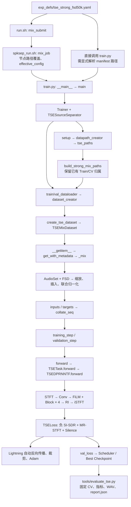
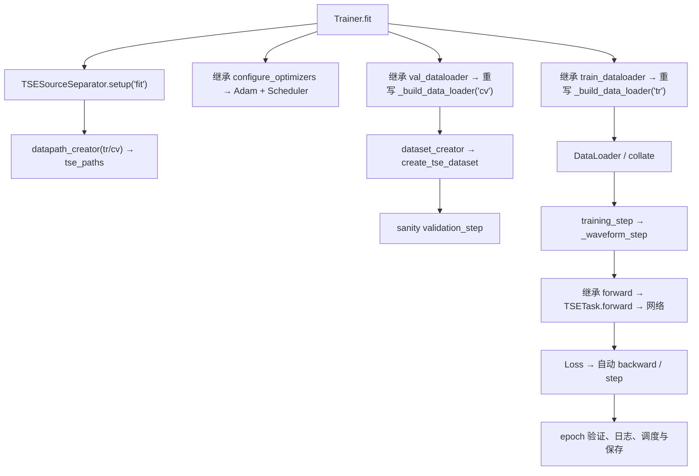
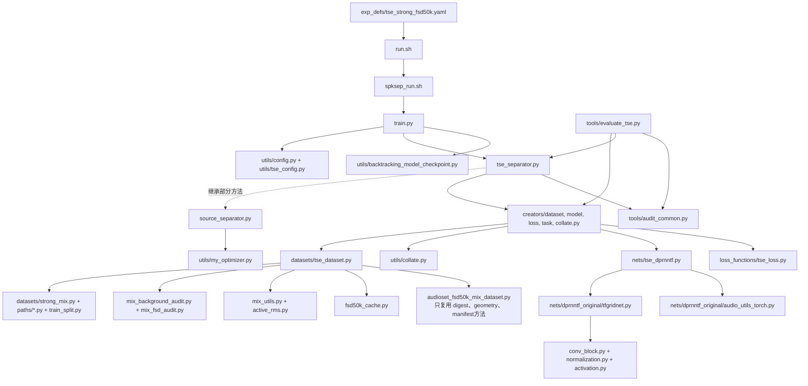
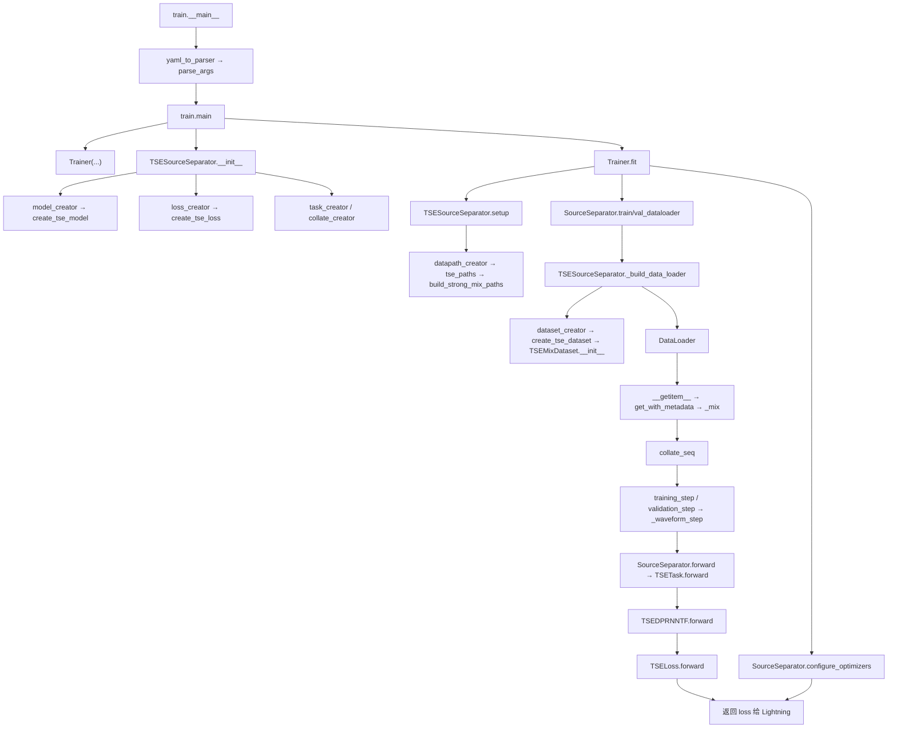
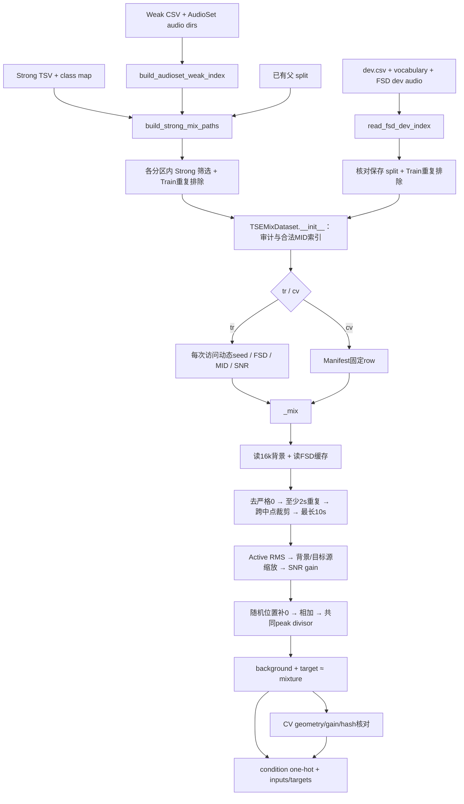
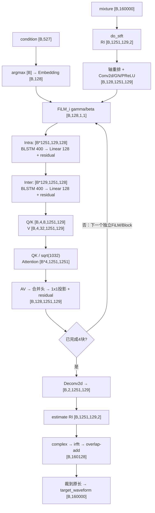
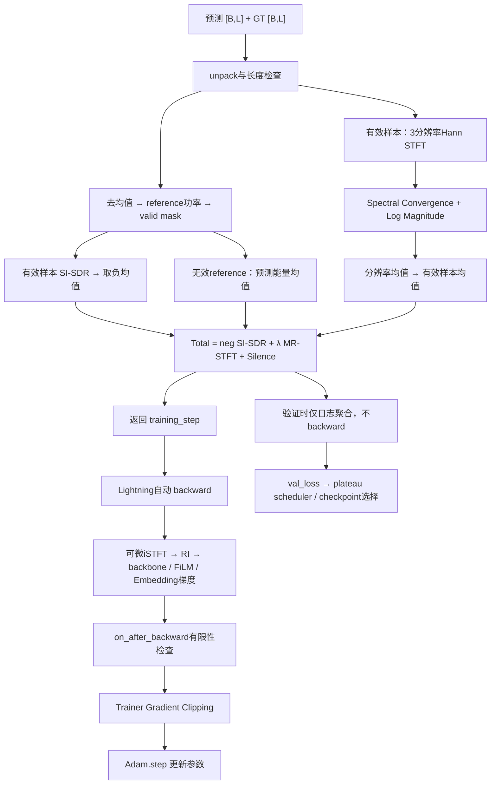

# MID-conditioned TSE 项目源码教材

> 分析基准：当前工作区源码，Git HEAD `6fdc42e`；整理日期：2026-10-20。
> 主配置：`exp_defs/tse_strong_fsd50k.yaml`。所有行号指本次分析时的源码。
> 本文仅做静态阅读与推导，没有实例化 Dataset、读取服务器音频、加载 Checkpoint、运行 forward、训练、测试或提交 Slurm。文中的 Shape 和数值示例不是实际运行结果。

> 2026-10-21 重构提示：下文保留编写时的源码快照与行号。当前混音链已精简为 `Dataset._mix → active_rms.make_snr_mixture → active_rms.mix_rms`；`mix_at_snr`、crop/full 分支及 `waveform_rms` 别名已删除，`compute_rms` 固定为 zero-mean。当前函数位置、调用审计、数值回归结果及新 CV Manifest 的操作说明见 [当前 RMS 口径](../tools/rms_zero_mean.md)。

这套程序学习的是：给定一条 10 秒混合波形和一个 AudioSet MID，输出本次合成时插入的 FSD 音轨。最关键的语义是 **MID 选择整条经过处理的 FSD stem**。若该文件同时包含狗叫和人声，选择狗叫 MID 时，GT 仍包含这条 FSD stem 中的人声。当前代码没有把多标签文件进一步分解成类别纯净的源。

本文沿真实调用链前进。对于框架自动完成而仓库没有实现的环节，会标注为 Lightning/PyTorch 托管；对于缺少数据或实验记录而无法确定的情况，会标注“无法从静态代码确认”。代码注释、旧文件名与执行语句不一致时，以执行语句为准。

## 目录

- [第 1 章：项目整体架构](#ch1)
- [第 2 章：配置文件详解](#ch2)
- [第 3 章：训练入口与整体调度](#ch3)
- [第 4 章：Dataset 的完整构造过程](#ch4)
  - [4.1 从工厂进入构造函数](#dataset-construction)
  - [4.2 AudioSet 来源、Strong 筛选与划分](#background-index)
  - [4.3 FSD 索引、有效 MID 与合法配对](#fsd-index)
  - [4.4 单个样本的完整生成过程](#sample-generation)
  - [4.5 Train、CV、Manifest 与随机性](#train-cv)
  - [4.7 Dataset 返回字段](#dataset-fields)
- [第 5 章：DataLoader 与 Collate](#ch5)
- [第 6 章：TSE 网络模型详解](#ch6)
  - [6.1 构造、复用关系和输入契约](#model-construction)
  - [6.2 Waveform → STFT → Conv2D](#model-stft)
  - [6.4–6.5 MID Embedding 与 FiLM](#model-film)
  - [6.6–6.11 DPRNNTF Block：频率、时间与注意力](#model-block)
  - [6.12–6.13 RI Mapping 与 iSTFT](#model-output)
  - [6.14 完整 Tensor Shape 表](#model-shapes)
- [第 7 章：Loss 的实际计算过程](#ch7)
- [第 8 章：Training、Backward 与参数更新](#ch8)
- [第 9 章：Validation 和 Checkpoint](#ch9)
- [第 10 章：推理与评估](#ch10)
- [第 11 章：完整样本贯穿实例](#ch11)
- [第 12 章：全项目调用关系总结](#ch12)
  - [12.1–12.5 五张调用与数据流图](#all-diagrams)
  - [12.6 从第一步到最后一步的追踪表](#trace-table)
  - [12.7 待核查与实现边界](#limitations)

## 阅读约定

| 符号 | 含义 | 主配置静态值 |
|---|---|---|
| $B$ | Batch Size；尾批可能更小 | 通常 2 |
| $L$ | 每条时域波形采样点数 | 160000 |
| $T$ | 模型 STFT 时间帧数 | 1251 |
| $F$ | 模型 STFT 单边频点数 | 129 |
| $C$ | 主干特征通道数 `tse_emb_dim` | 128 |
| $D$ | 类别向量维度 `tse_condition_dim` | 128 |
| $H_r$ | LSTM 单方向 hidden size | 200 |
| $H_a$ | Attention 头数 | 4 |
| $E$ | 每头、每个频点的 Q/K 通道数 | 8 |
| $K$ | 类别总数 | 527 |

源码 Block 内用 `Q` 表示频率长度，也用 `Q` 表示 Query Tensor；本文用 $F$ 表示频率长度，避免混淆。`T` 不等于采样点数 `L`，也不等于旧 SED 的 625 帧。

引用格式为 **`文件路径:行号`，`类名.函数名`**。行号一般指函数定义；同一函数中需要定位分支时另列分支行号。源码相对路径均以仓库根目录为基准。

<a id="ch1"></a>
## 第 1 章：项目整体架构

### 1.1 先看完整训练链



图中构建 Dataset、生成缓存、写 Manifest、保存报告，是**程序运行时的行为**，不是本次文档任务执行过的操作。

### 1.2 系统的输入、监督和产物

一个训练样本有两份字典：

- `inputs`：混合波形 `mixture_waveform` 和 one-hot `condition`。
- `targets`：目标波形 `target_waveform`、背景波形、混合波形副本，以及类别和样本身份。

模型只消费 `inputs`，输出 `{'target_waveform': estimate}`。Loss 主要消费 estimate 和目标波形。背景波形不是第二个预测目标，也不直接进入当前训练 Loss。

训练产生网络权重、优化器/调度器状态、日志和统计报告；离线评估脚本使用固定 CV mixtures 计算 SI-SDR、SI-SDRi、MR-STFT 等。当前不建立 TSE test Dataset，也不自动执行 DCASE 官方评测。

### 1.3 主要文件及职责

| 文件 | 在主链中的职责 | 核心定位 |
|---|---|---|
| `exp_defs/tse_strong_fsd50k.yaml` | 定义 TSE 数据、网络、Loss、训练参数 | 第 5–94 行 |
| `run.sh` | 选择 TSE 提交分支、冻结配置、调用调度器或下一层 shell | `mix_submit` 第 9 行，TSE 分支第 44 行 |
| `spksep_run.sh` | 按计算节点解析数据路径，生成有效配置并启动 Python | `mix_job` 第 7 行 |
| `train.py` | 解析参数、设随机种子、创建 Trainer 和任务外壳 | `main` 第 71 行 |
| `utils/config.py` | YAML 字段转成 argparse 参数 | `yaml_to_parser` 第 35 行 |
| `utils/tse_config.py` | 限定本版 TSE 的合法配置 | `validate_tse_config` 第 5 行 |
| `creators/*.py` | Dataset/Model/Loss/Task/Collate 分发 | 各 creator 函数 |
| `tse_separator.py` | TSE 专用 Lightning 生命周期、指标及恢复检查 | `TSESourceSeparator` 第 25 行 |
| `source_separator.py` | 被继承的 forward、优化器、worker 初始化、loader 入口 | 第 104、303、320、346、350 行 |
| `datasets/tse_dataset.py` | 合法配对、动态训练样本、固定 CV、波形监督字典 | `TSEMixDataset` 第 52 行 |
| `datasets/strong_mix.py` | 复用 Strong 背景筛选、已有划分、显式重复排除 | `build_strong_mix_paths` 第 117 行 |
| `datasets/paths/*.py` | 路径解析、AudioSet/FSD 标签与文件索引 | 第 4 章逐项定位 |
| `datasets/fsd50k_cache.py` | FSD 转单声道、重采样、缓存完整性 | `read_cached_fsd` 第 31 行 |
| `datasets/mix_utils.py` | 去零、重复、裁剪、位置随机、SNR 调度 | `make_snr_mixture` 第 338 行 |
| `datasets/active_rms.py` | Active RMS 和实际混音、共同峰值缩放 | `active_rms` 第 30 行，`mix_rms` 第 70 行 |
| `utils/collate.py` | 把样本递归整理成 Batch | `collate_seq` 第 11 行 |
| `nets/tse_dprnntf.py` | 波形接口、MID Embedding、FiLM、主干调用 | `TSEDPRNNTF.forward` 第 53 行 |
| `nets/dprnntf_original/tfgridnet.py` | 老师 DPRNNTF 层构造及完整 Block | `DPRNNTF` 第 310 行，Block 第 26 行 |
| `nets/dprnntf_original/audio_utils_torch.py` | 实际使用的 STFT、手写 overlap-add iSTFT | 第 48、116 行 |
| `loss_functions/tse_loss.py` | 波形 SI-SDR、MR-STFT、Silence Loss | `TSELoss.forward` 第 70 行 |
| `utils/backtracking_model_checkpoint.py` | Best/Last 保存及 sidecar | 类定义第 9 行 |
| `tools/evaluate_tse.py` | 固定 CV 检查、Checkpoint 推理、WAV 和 JSON | `run` 第 34 行 |
| `tools/audit_common.py` | 数据身份与字节内容泄漏检查 | `leakage_report` 第 52 行 |

### 1.4 与旧 SED 共用什么，替换什么

共用的是启动/配置基础设施、creator 分发、部分 `SourceSeparator` 方法、collate、路径索引、背景划分、FSD 缓存、混音函数、Manifest 锁和原子写机制、Adam/Scheduler、Checkpoint callback。

TSE 使用独立的 `TSEMixDataset`，并没有继承整个 `AudioSetFSD50KMixDataset`。它只在 `datasets/tse_dataset.py:164` 将旧类的 `_load_or_create_manifest` 当作未绑定方法调用，传入 TSE 自己的 `self`。因此此方法里的 `self._generate_manifest` 实际分派到 TSE 版本，而不是旧 SED 版本。

`TSESourceSeparator.__init__`（`tse_separator.py:26`）直接调用 `pl.LightningModule.__init__`，没有执行 `SourceSeparator.__init__`。所以不会创建旧的 `ConditionalFrameAccuracy` 等对象。TSE 也不调用旧 `_step`、BCE、logmel 特征管线或 frame GT 生成器。Python 导入依赖中出现旧模块，不代表执行了它们的训练流程。

从当前结构可明确辨认的 TSE 专用组件包括 Dataset 配对和波形返回接口、`TSETask`、`TSEDPRNNTF`、FiLM、`TSELoss`、TSE Lightning hooks、配置验证和评估入口。这里是**结构上的新增/适配关系**；没有通过版本历史声称某个提交究竟修改过哪些文件。

### 1.5 老师 DPRNNTF 与当前模型

`TSEDPRNNTF.__init__`（`nets/tse_dprnntf.py:33`）创建一个 `DPRNNTF` 对象作为 `backbone`，复用：

1. 输入层 `conv0-0`；
2. `dual_rnn` 中每一个完整 Block；
3. 输出层 `deconv0`。

但 TSE **没有调用 `DPRNNTF.forward`**。原 forward（`tfgridnet.py:380`）从 `target_dict['mix_ri'][0]` 取输入，并包含多麦克风、额外特征、mask/mapping 等接口；TSE 改为从混合波形自行 STFT，逐层调用上面的子模块，中间注入 FiLM，再重建目标波形。这里的复用是代码结构复用，不是加载老师预训练权重；当前配置禁止 `init_model_checkpoint`。

**本章衔接：** 输入是 YAML 与两个数据源，输出目标是条件化单条波形及训练结果。下一章把 YAML 的每个相关参数连接到实际消费者。

<a id="ch2"></a>
## 第 2 章：配置文件详解

### 2.1 三层“配置值”不能混为一谈

1. **源码 YAML 值**：下表基于 `exp_defs/tse_strong_fsd50k.yaml:5` 起的内容。
2. **启动覆盖值**：`spksep_run.sh` 根据节点覆盖六个存储字段，再通过命令行覆盖输出位置、GPU 和设备数。
3. **某次真实运行值**：需要该 run 的 `effective_config.yaml`、实际命令行、日志或 Checkpoint `hyper_parameters` 才能确定。本次未读取实验权重或服务器记录，不能把默认值称为某次训练的实际参数。

`utils/config.py:35` 的 `yaml_to_parser` 用 `yaml.safe_load` 读 YAML；每个键 `_` 替换为 `-` 后成为 CLI 选项。例如 `tse_condition_dim` 对应 `--tse-condition-dim`。字符串、布尔、其他 YAML 值分别使用 `strings_with_none`（第 19 行）、`bool_string_to_bool`（第 26 行）、`yaml_value`（第 5 行）解析。CLI 覆盖 YAML 默认值；YAML 本身也定义了允许哪些 CLI 参数。

### 2.2 任务、路径与数据策略

| 配置项与主 YAML 值 | 消费函数/位置 | 实际影响 |
|---|---|---|
| `dataset: audioset_strong_fsd50k_tse` | `creators/dataset.py:25,65` | 分派至 `tse_paths`、`create_tse_dataset`，不进入 SED Dataset |
| `task_type: tse` | `train.py:72`；`creators/task.py:22` | 选择 `TSESourceSeparator`、`TSETask` |
| `model_name: TSEDPRNNTF` | `creators/model.py:18` | 调用 `create_tse_model` |
| `loss_type: tse` | `creators/loss.py:16` | 调用 `create_tse_loss` |
| `feature_type: waveform` | `validate_tse_config` 第 5 行 | 限定波形路线；TSE Dataset 直接返回 waveform |
| `collate_type: sequence`、`pad_back_or_front: 0` | `creators/collate.py:11` | 递归 collate，数组若不等长则尾部补零；TSE Loss 另外拒绝波形长度不齐 |
| `data_path: /hdd2/syy12632604/AudioSet` | `resolve_path`，`datasets/paths/audioset_paths.py:26` | **相对数据路径相对 data_path，不是仓库根目录或 YAML 目录** |
| `class_map_path: metadata/class_labels_indices.csv` | `load_class_map` 第 52 行 | MID → 0..526 的索引映射 |
| `mix_audio_dirs: [/hdd2/cse30029918/corpora/AudioSetRaw/balance_wav]` | `build_audioset_weak_index` 第 12 行 | 搜索背景文件；由节点启动器覆盖 |
| `mix_weak_csvs: [metadata/balanced_train_segments.csv]` | 同上 → `read_weak_labels` | 背景 clip ID、YouTube ID、Weak MID |
| `mix_strict_paths: false` | `build_audioset_weak_index` 第 72 行 | 找不到背景文件时先记录并跳过；已有 split 的 inventory 校验仍可能因缺文件而失败 |
| `mix_strong_tsv: metadata/audioset_train_strong.tsv` | `build_strong_mix_paths` 第 122 行 | 筛选拥有有效 Strong 正类的背景，补充冲突 MID |
| `mix_strong_annotation_complete: true` | 主 YAML 第 66 行 | **当前 TSE 调用链未用它生成监督或改变筛选**；旧 Strong SED 使用，TSE checkpoint 前缀检查仍会比较它 |
| `mix_parent_background_split_path: mix_train_cv_seed7/audioset_background_seed7.json` | `build_strong_mix_paths` 第 132 行 | 必须已存在，保持父 Train/CV 归属 |
| `mix_background_split_path: strong_mix_full_gt_v1/background_split.json` | 同函数第 180 行 `_persist` | 保存/校验 Strong 过滤后的 inventory，不是重新随机划分 |
| `train_val_fraction: 0.15`、`train_split_seed: 7` | `split_train`，`datasets/train_split.py:25` | 校验已有父划分设置；比例对应视频数而非过滤后 clip 数 |
| `mix_fsd_dev_audio: /data/cse12110411/FSD50K/FSD50K.dev_audio` | `read_fsd_dev_index` 第 146 行 | `fname.wav` 文件来源 |
| `mix_fsd_ground_truth: /data/cse12110411/FSD50K/FSD50K.ground_truth` | 同上 | 读取 `dev.csv` 与 `vocabulary.csv` |
| `mix_fsd_split_path: mix_train_cv_seed7/fsd_official_train_val.json` | `create_tse_dataset` 第 278 行 | 对比 official train/val ID 列表与顺序 |
| `mix_cache_dir: tse_phase1_v1/fsd_cache_16k` | `read_cached_fsd` 第 31 行 | TSE 单独的 16 kHz 缓存 |
| `mix_cv_manifest_path: tse_phase1_v1/cv_{node}.json` | shell 第 77 行；`create_tse_dataset` 第 265 行 | shell 替换节点；直接 Python 留下 `{node}` 会报错 |
| `mix_content_duplicate_exclusions` | `exclude_declared_train_entries`，`strong_mix.py:86` | 从 Train 背景排除 `iZtF1lUPbEQ_20000`，从 Train FSD 排除 `51749`；声明 ID 不存在也报错 |
| `mix_zero_fsd_policy: exclude`、`mix_zero_background_policy: exclude` | `TSEMixDataset.__init__` 第 82–91 行 | 排除审计认定的零音频；格式无效音频直接报错 |
| `tse_no_pair_policy: error` | 同构造函数第 142 行 | 某背景没有任何合法目标 MID 时失败；可显式配置 `exclude` |

本地仓库没有 `metadata/class_labels_indices.csv` 这一文件。本次不从外部补充类别索引，后文狗叫示例使用符号 $j$，不捏造其真实编号。部署运行时上述相对路径实际指向 `data_path` 下的数据文件。

### 2.3 采样、混音和 Condition

| 配置 | 消费路径 | 效果与易误解点 |
|---|---|---|
| `samplerate: 16000` | TSE validator；混音常量 `mix_utils.py:18` | 本版固定 16 kHz；不是任意采样率管线 |
| `train_on_chunk: 10.0` | TSE validator；混音常量第 19 行 | 固定 160000 点，Train/CV 相同；不是运行时随机截 AudioSet 成 10 秒 |
| `rms_norm: 0` | TSE validator | 不启用旧 SED 特征归一化；**不代表混音时不做源 RMS 缩放** |
| `mix_seed: 7` | `create_tse_dataset` → `self.seed` → `_generate_manifest` | 固定 CV 抽样；Train 的动态种子来自全局 NumPy 流 |
| `mix_snr_db: null` | `TSEMixDataset._snr` 第 207 行 | 使用范围采样；非 null 的有限值优先固定 SNR |
| `mix_snr_db_range: [-5, 5]` | `_snr` → `sample_snr_db` 第 203 行 | 在 dB 区间均匀抽样，不是在线性增益区间均匀抽样 |
| `mix_fsd_rms_mode: active` | validator；`_mix` 固定传 `'active'` | FSD 用未补零 crop 的活动样本 RMS，背景用完整 10 秒 RMS |
| `mix_active_threshold_dbfs: -40.0` | `active_rms` 第 30 行 | 活动帧门限 $10^{-40/20}=0.01$ |
| `mix_active_frame_ms: 20.0` | 同函数 | 每帧 320 点，非重叠，尾帧不补齐 |
| `mix_normalization: peak` | validator；`_mix` 固定传 `'peak'` | 混合峰值大于 1 才共同缩小三条波形 |
| `num_classes: 527` | 索引校验、condition、模型、统计 | condition 长度 527，Embedding 有 527 行，不表示每类都会被采样到 |
| `tse_condition_dim: 128` | `create_tse_model` 第 86 行 → `nn.Embedding` 第 50 行 → 每个 `FiLM` | Embedding `[527,128]`；FiLM `Linear(128,128) → SiLU → Linear(128,256)` |

### 2.4 网络参数

| 配置 | 默认 | 实际传入和分支 |
|---|---:|---|
| `tse_emb_dim` | 128 | backbone 通道 C；FiLM 每个 gamma/beta 的长度；每头 V 通道为 C/4 |
| `tse_hidden` | 200 | intra/inter 单层双向 LSTM 每方向 200，输出 400 |
| `tse_layers` | 4 | 4 个独立 Block 和 4 个独立 FiLM |
| `tse_emb_ks` | 1 | LSTM 分组长度；输入特征 `C*emb_ks=128` |
| `tse_emb_hs` | 1 | 分组步长；与 ks 相等，实际用 reshape + Linear，不执行 unfold/ConvTranspose1d |
| `tse_seqmodel_type` | 3861 | `tfgridnet.py:347` 选择 `approx_qk_dim=1024`；3860 才是 512 |
| `tse_window` | 256 | `do_stft` window/FFT；F=129。类构造默认是 512，但工厂明确传 YAML 的 256 |
| `tse_hop` | 128 | 8 ms hop；validator 固定要求 128 |
| `tse_gradient_checkpointing` | true | `TSEDPRNNTF.forward:71` 在 training 且启用梯度时 checkpoint 整个 Block |

未暴露在 YAML、由适配器明确固定的构造值见 `nets/tse_dprnntf.py:43`：单源、单输入/输出麦克风、RI 两分量、无额外特征、mapping=1、`mag_sf=1`、PReLU、Block `LayerNormalization`、`convnormact_type=2`、首卷积启用激活。4 头和 `attn_mode=41` 则在老师构造函数 `tfgridnet.py:347` 固定。

### 2.5 Loss、优化与训练管理

| 配置 | 默认 | 读取者与运行作用 |
|---|---|---|
| `tse_mrstft_weight` | 1.0 | `create_tse_loss` → `TSELoss.forward`，只乘 MR-STFT 项 |
| `tse_mrstft_resolutions` | `[[256,64],[512,128],[1024,256]]` | `TSELoss.__init__:40`；每项为 FFT size 和 hop，使用普通 Hann |
| `tse_silence_rms` | `1e-5` | Loss 和 SI-SDR 指标；零均值 reference 功率严格大于阈值平方才有效 |
| `learning_rate` | `1e-4` | `SourceSeparator.configure_optimizers:303` → Adam |
| `decay_factor`、`patience` | 0.5、5 | `ReduceLROnPlateau_verbose`，监控 `val_loss` |
| `batch_size`、`num_workers` | 2、2 | `TSESourceSeparator._build_data_loader:89` |
| `shuffle` | true | 只打乱 Train，CV 固定顺序 |
| `epochs` | 50 | `train.main:123` 同时设 `min_epochs=max_epochs=50` |
| `seed` | 7 | `train.main:88` 设 Python/NumPy/Torch；worker 初始化也读取 |
| `gradient_clip_val` | 5.0 | `Trainer` 的梯度裁剪参数 |
| `precision` | `32-true` | `Trainer` 精度；模型 FFT 和 Loss 另显式禁用 autocast |
| `accumulate_grad_batches` | 1 | `Trainer` 默认每批更新一次，没有跨多批累积 |
| `accelerator`、`devices`、`distributed_backend` | gpu、1、auto | `trainer_device_config:21`；TSE validator 限单设备 |
| `cudnn_deterministic`、`cudnn_benchmark` | 1、0 | 转 bool 后设置 cudnn 和 Trainer |
| `train_percent_check`、`val_percent_check` | 1.0、1.0 | `limit_train_batches`/`limit_val_batches`；shell 要求浮点 1.0 表示全量 |
| `num_sanity_val_steps` | 10 | Trainer 正式训练前验证检查的批次数 |
| `log_every_n_steps` | 10 | Trainer 日志频率 |
| `save_path`、`save_name` | experiments、tse_dprnntf_phase1_b2_w256_lr1e4 | `MyTensorBoardLogger` 和运行目录；shell 会改写 save_name |
| `init_model_checkpoint` | null | validator 拒绝非空；本版新训练从随机权重开始 |
| `test_after_fit` | false | validator 要求 false；因此不走 `trainer.test` |

Checkpoint 监控项不是 YAML 参数，而是 `train.py:_checkpoint_callback:45` 固定：`monitor='val_loss'`、`mode='min'`、`save_top_k=1`、`save_last=True`、`save_weights_only=False`、每 epoch 保存判断一次。

### 2.6 启动方式的差异

主 shell 链需要显式的 `--dataset audioset_strong_fsd50k_tse`，仅给 `--exp-def` 不会自动把 shell 切到 TSE 模式。`run.sh:142` 和 `spksep_run.sh:237` 都先扫描 `--dataset`。不显式选择会保留旧 SED shell 分支。

| 方式 | 配置如何变化 |
|---|---|
| `run.sh` 的 TSE 提交分支 | 冻结提交 YAML → `spksep_run.sh` 节点路径覆盖 → 保存 effective config → Python CLI 再覆盖输出路径/名称/GPU/设备 |
| 在已有 Slurm allocation 中进入 TSE shell | 不重新 sbatch，但仍交给 `spksep_run.sh` 做路径解析；训练模式要求 Slurm job ID |
| 直接 `train.py --exp-def ...` | 没有 shell 节点覆盖；必须自行传明确的 `--mix-cv-manifest-path`，以及正确的路径；Python 默认 exp-def 是旧 SED |
| `resume_training.py` | 从 `mylast.ckpt` 的 hyperparameters 恢复，继续同一训练状态，而非重新读取主 YAML 的最新值 |
| `tools/evaluate_tse.py` | 默认选 TSE YAML，可用 CLI 覆盖；有 checkpoint 时还严格比对关键设置 |

节点覆盖来自 `spksep_run.sh:47`：ailab01 的 `data_path` 是 `/hdd2/syy12632604/AudioSet`，ailab02 是 `/data/syy12632604/AudioSetMix`；后者背景目录也切换为其 `audio/balance_wav`。两者配置的 FSD 源目录相同。TSE cache 和 manifest 根据所选 data root 解析，`{node}` 替换为具体节点。ailab03 路线拒绝运行。

历史文件 `exp_defs/tse_strong_fsd50k_b4_lr1e4.yaml:6` 现在同样是 **batch=2、LR=1e-4、window=256**。不能从文件名的 `b4` 推断当前参数。

**本章衔接：** YAML + 节点/CLI 覆盖形成 `hparams`；它随后控制 Trainer、creator 和 Dataset。下面追踪这些对象创建的实际先后关系。

<a id="ch3"></a>
## 第 3 章：训练入口与整体调度

### 3.1 shell 真正做了哪些转交

`run.sh:mix_submit:9` 在 TSE 分支（第 44 行）设配置、保存前缀、job name 和默认 `num_jobs=1`。第 90–104 行只读配置并做检查；提交分支第 106–130 行复制快照、组装 sbatch 参数，实际把 **`spksep_run.sh` 本身作为作业脚本**。不能把旧 `slurm/audioset_current_train_ailab01.sbatch` 当作当前 TSE 的必经入口。

`spksep_run.sh:mix_job:7` 依次：

1. 读取 shell 参数和实际节点；
2. 选择路径 profile，解析 cache/manifest；
3. 内部 `mix_effective_config`（第 103 行）读 YAML、更新六个路径字段、校验配置和必要文件；
4. 训练分支要求已有 cache 与 CV Manifest；`--check-dataset true` 的 TSE 路线在第 175–179 行改为运行评估脚本的数据审计模式，它可能创建派生缓存和 Manifest；
5. 新训练在第 201–208 行创建独占 run 目录，保存 `submitted_config.yaml`、`effective_config.yaml`、`compute_node`；
6. 第 226 行调用 `train.py --exp-def <run>/effective_config.yaml`，额外指定 save path/name、GPU、单设备。

这里记录调用链，不提供本次要执行的训练命令；上述操作本次均未执行。

### 3.2 Python 入口如何获得 hparams

`train.py:165` 的模块入口先建一个只认识 `--exp-def` 的 parser：

```python
args, other_options = parser.parse_known_args()
hyperparams = yaml_to_parser(args.exp_def).parse_args(other_options)
main(hyperparams)
```

第一次解析负责确定 YAML，第二次解析才将其余 CLI 覆盖到 YAML 派生的 parser，输出 `argparse.Namespace`。之后 `main(hparams)`（第 71 行）：

1. `task_type == 'tse'` 时调用 `validate_training_data_config` → `validate_tse_config`。
2. 设置随机种子、cudnn 开关和 float32 matmul precision。
3. 创建 `MyTensorBoardLogger`（`utils/mytensorboardlogger.py:9`）。若有 `SLURM_JOB_ID`，用它作为 logger version；否则交给父 logger 选择。
4. 将 `hparams.save_path` 改为 `save_path/save_name/version_<version>`。
5. 创建 checkpoint callback；检查 run 根目录 `mylast.ckpt`。新 TSE run 若发现隐式恢复目标则报错，显式续训走另一分支。
6. 调用 `trainer_device_config`，GPU 请求但 CUDA 不可用则报错。
7. 创建 `Trainer`（第 123 行）。
8. **随后**创建 `TSESourceSeparator(hparams)`（第 148 行）。
9. `trainer.fit(model, ckpt_path=resume_from)`（第 158 行）。

注意：代码是先创建 Trainer 对象，再创建 LightningModule；Dataset 还没有在 `train.main` 里直接实例化。

### 3.3 四个 creator 如何接入 TSE

`TSESourceSeparator.__init__`（`tse_separator.py:26`）验证参数并 `save_hyperparameters`，然后依次：

```text
model_creator(hparams)
  → nets/tse_dprnntf.py:create_tse_model:86
  → TSEDPRNNTF.__init__:33
loss_creator(hparams)
  → loss_functions/tse_loss.py:create_tse_loss:90
  → TSELoss.__init__:40
task_creator(hparams)
  → creators/task.py:TSETask
collate_creator(hparams)
  → partial(collate_seq, pad_back_or_front=0)
```

Model 和 Loss 成为 LightningModule 的子模块；Task 是转交 forward 的普通对象；collate 是 DataLoader 后续使用的 callable。构造结束时 `split_paths=None`、`datasets={}`，只准备了训练所需对象，没有在此取得音频样本。

### 3.4 `Trainer.fit` 后的职责边界

框架根据 hook 协议组织下面的生命周期。具体内部私有函数和全部回调先后顺序没有在项目中实现，不虚构仓库函数：



`setup`（`tse_separator.py:52`）只接受 `None/fit/validate`，构建 tr/cv 路径，并检查背景视频不交叉。继承的 `train_dataloader`/`val_dataloader`（`source_separator.py:346,350`）调用的是 `self._build_data_loader`，因此动态分派到 **TSE 重写版本**（`tse_separator.py:61`）。

这也是阅读继承关系时最容易走错的一步：看到父类 loader 入口，不应继续照着父类的 `_build_data_loader` 解释 TSE。

**本章衔接：** `hparams` 已变成网络、Loss、Task 和 Trainer；`setup` 形成路径列表，loader 构造时才创建 Dataset。下一章进入路径列表如何变成一个真实样本。

<a id="ch4"></a>
## 第 4 章：Dataset 的完整构造过程

<a id="dataset-construction"></a>
### 4.1 从工厂进入构造函数

`TSESourceSeparator._build_data_loader` → `creators/dataset.py:dataset_creator:65` → `datasets/tse_dataset.py:create_tse_dataset:262`。

`create_tse_dataset(hp, partition, path_list=None, is_training=None)` 的输入来自 Lightning 的超参数、`'tr'/'cv'` 和 setup 生成的背景列表。它：

1. 检查 partition；若显式传 `is_training`，必须与 partition 一致。
2. 拒绝含未解析 `{node}` 的 CV 路径。
3. 建立相对 `hp.data_path` 的 `resolve`。
4. 调用 `read_fsd_dev_index`，得到官方 train/val FSD pools。
5. 再读 `dev.csv`，补充每条 FSD 的 `original_mids`，保留模型词表以外的原始标签供歧义统计。
6. 读取保存的官方划分 JSON，逐列表核对 strategy 和 train/val FSD IDs。
7. 从 train pool 排除声明的内容重复 ID。
8. 将本 partition 的 background list 和 FSD pool、缓存/Manifest、SNR/active RMS 策略传给 `TSEMixDataset`。
9. 添加重复排除报告，返回 Dataset 对象给 loader。

若调用者不传 `path_list`，第 284 行经 `tse_paths` 自行构建背景路径。训练 setup 已传列表；离线评估直接调用 creator 时通常走自行构建路线。

`TSEMixDataset.__init__`（第 53 行）不是只保存参数。它会排序、审计源音频、过滤、建立按 MID 索引、生成统计，而且 CV 会加载或生成固定 Manifest。因而仅“创建 Dataset 看看长度”也可能读全部源文件和写派生文件；本文不调用它。

<a id="background-index"></a>
### 4.2 AudioSet：来源、筛选和固定划分

#### 4.2.1 路径解析与 Weak 索引

`datapath_creator` → `tse_paths`（`datasets/tse_dataset.py:255`）→ `build_strong_mix_paths`（`datasets/strong_mix.py:117`）。

后者先调用 `build_audioset_weak_index`（`datasets/paths/audioset_weak_paths.py:12`），输入 audio dirs、weak CSVs、class map 和 data root，返回 `{'entries': [...], 'report': ...}`。

具体内部顺序：

- `resolve_path/resolve_paths`（`audioset_paths.py:26,37`）：展开环境变量和 `~`；绝对路径原样使用，相对路径拼接 data root。
- `load_class_map`（第 52 行）：读取 `index,mid,display_name`，建立字典及按 index 排列的名称列表；Weak index 进一步要求严格 527 类、索引 0..526。
- `read_weak_labels`（第 102 行）：跳过注释，识别官方四列或扩展表头，解析时间、MID；默认 `_clip_id`（第 98 行）把起始秒乘 1000 并取整，形成 `YTID_<毫秒>`。
- `_resolve_audio`（第 194 行）：优先 manifest 提供的路径；再按 clip ID、YTID、允许扩展名找文件。优先目录保持 CSV 与音频来源的对应关系。
- 无文件则记录 missing 并跳过；没有可映射 MID 则跳过。绝对 realpath、clip ID、YTID 冲突会报错；重复但一致的同 clip 元数据会合并标签。

每条 entry 有 `id`、`audio_path`、`ytid`、`weak_mids`、`class_indices`、`original_weak_mids`、clip 起止时间。保留 original Weak 标签是为了后面的冲突过滤不丢失词表外信息。

#### 4.2.2 Strong 并不直接成为波形 GT

`read_strong_labels`（`audioset_paths.py:159`）将 TSV 转成按 clip 分组的事件列表。四列格式默认 `PRESENT`；第五列支持 `PRESENT/NOT_PRESENT`，保留 `onset,offset,mid,present`。

`_validate_strong_intervals`（`strong_mix.py:47`）要求有限且 `0 <= onset <= offset <= 10`；零时长事件排除，其余保留并统计。注意源码旁边“生成 full GT”的旧注释不等于 TSE 正在生成帧 GT。

`build_strong_mix_paths` 在第 138 行仍使用旧筛选网格：

$$
t_k = k\cdot256/16000,\qquad k=0,\dots,624.
$$

对每个映射内的 Strong 正类构建 `positive/negative` 布尔数组，用 `[onset,offset)` 判断网格点。**实际保留条件是 `positive.any()`；这里计算了 negative，却没有用 negative 抵消 positive。** 至少一个类别有正网格点，才保留该背景。其 `strong_positive_mids` 和全部有效事件被写入 entry。

625 点仅服务背景筛选，后面不会作为 TSE 的模型帧数或 Loss mask。真实模型主配置有 1251 个 STFT 帧。

#### 4.2.3 Train/CV 归属如何保留

`build_strong_mix_paths:132` 首先要求父 split 文件存在，再调用 `datasets/train_split.py:split_train:25`。在此上下文中只走其已有文件校验路径：

- 已保存 `strategy/seed/val_fraction` 必须匹配；
- `saved['tr'] + saved['cv']` 的全部 clip IDs 必须匹配当前 Weak index；
- Train/CV 不得重叠或为空；
- 同一 `video_id` 不得跨分区。

通用 `split_train` 中虽有按 SHA256 视频排序新建划分的代码，但 **TSE 外层先要求父文件存在，正常不会进入新建父划分分支**。

随后在各自 partition 内做 Strong 筛选，不对交集重新划分；再由 `exclude_declared_train_entries`（`strong_mix.py:86`）只从 Train 排除指定重复条目。它检查 ID 列表类型、重复声明、声明必须真实存在，返回有效列表和排除报告。

`_persist`（第 28 行）将 Strong 筛选结果和 parent/strong/class map hashes 写入派生 split；已有文件则要求内容完全一致。文件锁和临时文件 `os.replace` 保证发布完整性。

#### 4.2.4 泄漏检查的层次和边界

路径构造阶段检查视频 ID、路径交叉；`TSESourceSeparator.setup:57` 再次检查视频；两个 Dataset 都建好后，`_build_data_loader:76` 调用 `leakage_report(full=True)`（`tools/audit_common.py:52`）。

后者先由 `_identity_leakage_report:37` 检查背景 clip/video/path 和 FSD ID/path，再对两种数据源的 tr/cv 原文件计算 SHA256：

- 同一语料 Train/CV 不得有文件字节完全相同的音频；
- AudioSet 与 FSD 之间所有分区也不得有字节完全相同的文件。

**实现边界：** 文件字节哈希不能识别重新编码、不同 WAV header、重采样后的同源录音；不同 FSD ID 也不能自动证明录音来源独立。代码提供这些确定性检查，但“完全不存在任何语义或近重复泄漏”无法从静态代码确认。

<a id="fsd-index"></a>
### 4.3 FSD：官方划分、有效 MID、冲突与抽样

#### 4.3.1 用的到底是哪一个 FSD 索引函数

当前调用的是 `datasets/paths/fsd50k_paths.py:read_fsd_dev_index:146`，不是同文件第 44 行支持更广分区的 `build_fsd50k_index`。

它只访问 dev audio 和 `dev.csv/vocabulary.csv`：

1. `_read_vocabulary:26` 读取无表头三列，验证连续索引、MID、名称唯一性。
2. 要求 dev.csv 有 `fname,labels,mids,split`，split 只能 `train/val`。
3. FSD ID 必须是规范的非负数字字符串；所有行跨 split 检查重复 ID 和文件路径。
4. `labels` 与 `mids` 数量一致，名称/MID 必须符合 vocabulary。
5. 将原 MID 与 AudioSet 527 类映射取交集形成 `mids`。
6. 文件必须存在；若没有映射内 MID，不加入 pool。
7. 每个 pool 按数字 FSD ID 排序，返回两个列表及统计。

FSD Train 只供 TSE Train；FSD 官方 val 只供 TSE CV；本链不打开 FSD eval。创建函数再核对已有 split JSON 后排除 Train 重复项，避免悄悄换划分。

#### 4.3.2 构造时如何排除无效音频

`TSEMixDataset.__init__:82` 调用：

- `audit_backgrounds`（`mix_background_audit.py:32`）→ `inspect_background:14`：读取背景，验证 16 kHz、160000 点、有限、单声道均值；全零单声道标记 `zero_mono`。
- `audit_fsd_pool`（`mix_fsd_audit.py:48`）→ `inspect_fsd:19`：读取原 FSD，要求 16k/44.1k、非空、有限；通道平均后全零或零均值 RMS 为零都标记排除；前后源 hash 必须相同。

无效格式/坏文件触发失败；零音频按 `exclude/error` 决定。然后构造有效 `fsd_pool`、`fsd_by_id`。

**待核查：** 背景审计只用 `not np.any(waveform)` 判零，非零常量 DC 背景可能被标 `ok`，但后续 `normalize_rms` 会因零均值 RMS=0 拒绝。不能把 `exclude` 解读为“已排除所有零方差背景”。这只是静态发现，本文不修改。

#### 4.3.3 合法 Condition 的精确集合

`forbidden_mids(background)`（`tse_dataset.py:29`）返回：

$$
\mathcal B =
\text{original Weak MID}
\;\cup\;\text{strong\_positive\_mids}
\;\cup\;\{\text{有效 events 中 present=True 的 MID}\}.
$$

这里“+”表示集合并。即使某个极短 Strong 事件没落在 625 个筛选网格上，只要是保留下来的有效正事件，它的 MID 仍会进入最后一项。

构造函数第 93 行建立 `by_mid[mid] = 包含该 mapped MID 的所有 FSD entry`。对于每个背景：

$$
\mathcal A_b=\operatorname{keys}(\text{by\_mid})\setminus\mathcal B_b.
$$

`allowed[background_id]` 保存排序后的合法 MID。若为空，收集进 `blocked`；主配置 `tse_no_pair_policy=error` 抛 `NoLegalPairError` 并附 report。

这是**精确字符串 MID 排除**，没有 ontology 父子类扩展，也没有按声音内容检测。更不是“FSD 所有标签与背景标签集合完全不相交”：被检查的是本次选中的一个 MID，FSD 其他共现 MID 可以与背景重叠。

#### 4.3.4 `_select` 的概率，不是简单类别均衡

`TSEMixDataset._select(background,rng)`（第 177 行）由 Train 样本生成或 CV Manifest 生成调用。

若 FSD 文件 $e$ 有 $k_e=|\operatorname{set}(e['mids'])|$ 个映射内 MID，构造阶段为其每个 MID 分配权重 $w_e=1/k_e$。对每类：

$$
M_m=\sum_{e:m\in e['mids']}1/k_e.
$$

执行时先在背景合法 MID 中按 $M_m$ 选 MID，再在该 MID 下按 $1/k_e$ 选文件：

$$
P(m\mid b)=\frac{M_m}{\sum_{u\in\mathcal A_b}M_u},\qquad
P(e\mid m,b)=\frac{1/k_e}{M_m}.
$$

故合法 pair 概率：

$$
P(e,m\mid b)=\frac{1/k_e}{\sum_{u\in\mathcal A_b}M_u}.
$$

它等价于先均匀选有效 FSD 文件、再均匀选该文件 mapped MID、最后以合法性为条件的分布；直接两步加权采样避免无界拒绝循环。它不保证类别均匀，也不保证经过合法性条件筛选后每个文件仍等概率。

例如一个单标签文件只有 A，另一个双标签文件有 A/B，且背景均允许：质量为 $M_A=1.5,M_B=0.5$，于是 $P(A)=0.75,P(B)=0.25$。三种合法 pair 概率为 0.5、0.25、0.25。这个例子是概率教学，不是本地数据统计。

`is_multilabel`（第 40 行）统计时使用 `original_mids`，而抽样权重的分母使用 mapped `mids`；二者刻意区分。原始词表外标签也可能代表 stem 内的非目标声音。

<a id="sample-generation"></a>
### 4.4 单个样本：从 `__getitem__` 到三条波形

#### 4.4.1 最外层取样顺序

DataLoader 给 Dataset 一个背景 index，调用 `TSEMixDataset.__getitem__`（第 251 行）。它只返回 `get_with_metadata(index)[0]`。

`get_with_metadata`（第 230 行）：

1. `background = self.path_list[index]`。
2. CV 从同位置 Manifest row 取 `fsd_id,target_mid,seed,snr_db`。
3. Train 从全局 NumPy RNG 抽一个 int64 范围 seed；以它创建 `default_rng`，调用 `_select` 得 FSD 和 MID，再调用 `_snr`。
4. `_mix(...)` 读取并生成三条波形。
5. CV 重新构造 `_row` 与保存 row 作完整比较。
6. 建 `[527] float32` one-hot condition。
7. 组装 `(inputs,targets)` 和混音 metadata，返回 `sample,meta`。

普通 loader 丢弃 meta，只得到 sample；评估用 `get_with_metadata` 同时保留 meta。

#### 4.4.2 `_mix` 如何读取背景和 FSD

`TSEMixDataset._mix(background,fsd,mid,seed,snr_db)`（第 187 行）先重新验证 MID 属于 FSD 且不在背景禁用集合，再执行：

```python
bg, _ = read_mono_waveform(background['audio_path'])
raw_target, cache = read_cached_fsd(fsd['audio_path'], self.cache_dir)
bg, target, mixture, meta = make_snr_mixture(...)
```

背景读取函数 `mix_utils.py:read_mono_waveform:52`：

- `sf.info` 要求采样率正好 16000；不重采样；
- `sf.read(dtype='float32',always_2d=True)` 得 `[N,channels]`；
- 对 channel 取 float32 均值，得到 `[N]`；
- `_waveform:23` 要求一维、非空、有限，返回副本和原始信息。

背景之后由 `validate_background:65` 要求恰好 160000 点；长度不对报错，**不自动裁剪/重复/补零**。

FSD 读取函数 `fsd50k_cache.py:read_cached_fsd:31`：

1. 解析源路径与 cache root，cache 不得放在原音频目录内部。
2. `file_sha256:21` 分块读源字节，形成 hash。
3. 只允许 44100 或 16000 Hz，记录源路径/hash/rate/frame/channel 和软件版本。
4. 对 identity JSON 求 hash 形成 cache key；获取对应文件锁。
5. 命中时核对 identity 与缓存 WAV hash；未命中时读 float32 二维源、通道平均。
6. 44.1k 用 `resample_poly(mono,160,441,window=('kaiser',5.0),padtype='constant')`；16k 直接复制。
7. 写 `FLOAT` WAV 和 JSON 到临时文件，先发布 WAV、再发布 manifest；原 FSD 文件不改。
8. 重新读缓存，验证采样率和期望长度 $\lceil N_{\rm src}16000/f_{\rm src}\rceil$，返回 `[N_{16k}] float32` 和 cache 信息。

缓存保存的是**未做随机裁剪与混音的 16k 单声道源**，因此 Train 每次仍可动态生成不同 crop。

#### 4.4.3 FSD 清理、重复、裁剪：位置坐标如何改变

`make_snr_mixture`（`mix_utils.py:338`）首先再次验证合法 MID，然后调用：

```text
sample_rng(background_id, fsd_id, target_mid, seed):38
  → prepare_fsd_crop(fsd_waveform, rng):126
      → remove_zero_energy_samples:72
      → repeat_to_min_duration:81
      → sample_middle_crossing_segment:91
      → 截至最多 160000 点
```

`sample_rng` 将 `[背景ID,FSD ID,MID,seed]` 序列化后 SHA256，取前 16 字节转换为整数喂给 `default_rng`。这使几何随机性与身份绑定，不依赖 Python 内置 hash 的随机盐。

`prepare_fsd_crop` 的精确步骤：

1. `remove_zero_energy_samples` 执行 `value[value != 0]`，删除所有严格为零的采样点，包含内部零点和 `-0.0`。它不是按阈值剪掉首尾静音；会改变原始时间坐标和局部相邻关系。
2. `repeat_to_min_duration` 将清理后的波形 `np.tile` 到至少 2 秒。复制次数：
   $$
   c=\max(1,\lceil32000/N_{\rm nonzero}\rceil).
   $$
   不截到正好 2 秒，因此重复后长度可能更长。
3. `_rng:30` 对 Generator 深拷贝，或由整数建立新 Generator，避免修改传入 RNG 状态。
4. 从局部 generator 抽 `crop_seed,pad_seed` 两个 seed。
5. `sample_middle_crossing_segment` 对重复后长度 $N$，以 $M=8000$ 点（0.5 秒）为最短长度，抽：
   $$
   start\in[0,\min(\lfloor(N-1)/2\rfloor,N-M)],
   $$
   $$
   end\in[\max(\lfloor N/2\rfloor+1,start+M),N].
   $$
   两个区间含端点；代码 `integers` 的上界通过 `+1` 实现。先均匀 start，再在依赖 start 的区间均匀 end。返回半开片段 `[start:end]`。
6. 取 `segment[:160000]`。若原抽样段超过 10 秒，只保留前 10 秒，不再次随机裁剪。
7. 返回 crop、记录清理/重复/裁剪的 metadata 和 pad seed。

“跨中点”约束针对**截断前、清理重复后的源**；若又截至前 10 秒，最终 crop 不必仍跨该源中点。metadata 的 `sampled_crop_*` 与最终 `crop_*` 正是为此区分。这里的 crop 坐标不能直接当作原 FSD 文件的时间戳。

#### 4.4.4 RMS：中心化统计与波形本身要区分

`compute_rms`（`mix_utils.py:160`）将数据转 float64，计算：

$$
R(x)=\sqrt{\frac1N\sum_n(x_n-\bar x)^2}.
$$

空数组或常量数组返回 0。它中心化的是**统计用副本**。`normalize_rms`（第 185 行）实际输出 $x/R(x)$，并没有输出 $(x-\bar x)/R(x)$。因此它改变增益而不移除 DC，同时保持填入的 0 仍是 0。

这一区分同时影响背景、FSD 和 SNR：代码用零均值 RMS 衡量强度，但保留原波形偏置。

#### 4.4.5 Active RMS 真正测量了什么

当前 `make_snr_mixture` 令 `target=crop`，不先补零；调用 `mix_at_snr`（第 256 行）的 active 分支，再调用 `active_rms.py:mix_rms:70`。

`active_rms(crop,threshold_dbfs=-40,frame_ms=20)`（第 30 行）：

1. 原始 crop 转 float64，从样本 0 起按 320 点非重叠分帧。
2. 最后一帧按其真实长度计算，无 padding。
3. 每帧独立计算零均值 $R$，选 `frame_rms > 0.01` 的帧，等于门限不选。
4. 用 `np.repeat(selected,counts)` 将帧布尔值展开为与 crop 等长的 sample mask。
5. 如果有 active samples，对所有选中样本的并集重新计算一个零均值 RMS；不是平均各帧 RMS。
6. 如果没有 active frame，分母取 `max(R(crop),0.01)`，mask 全 false，metadata 标 `crop_rms_with_threshold_floor`。

mask 用来计算增益和诊断，**不把非 active 的声音删除或置零**。低能量部分仍留在整个 FSD stem，参与后续输出监督。active mask 在增益前固定，后面不重新阈值化。

#### 4.4.6 SNR 缩放、插入和相加的完整公式

记原背景为 $b_0$，最终未补零 crop 为 $c_0$，请求 SNR 为 $q$ dB。`mix_rms` 按如下顺序运行：

1. 背景源归一化：
   $$
   b_1=\operatorname{float32}(b_0/R(b_0)),\qquad R_b=R(b_1).
   $$
2. 获取 active reference $r$，源归一化 FSD：
   $$
   c_1=\operatorname{float32}(c_0/r).
   $$
3. `scale_foreground_to_snr`（`mix_utils.py:223`）对非 fallback 使用固定 active mask 测 $R_f=R(c_1[\text{mask}])$，计算：
   $$
   a=\sqrt{10^{q/10}}\frac{R_b}{R_f},\qquad
   c_2=\operatorname{float32}(a\,c_1).
   $$
   这对应前景/背景功率比 $10^{q/10}$。metadata 的 `target_gain=a/r` 是**相对原 crop、最终峰值缩放之前**的总增益。
4. fallback 分支强制 gain reference 为 1，而不是重新测量很小的 `c1` RMS 抵消前面的 floor。此时不保证实际 SNR 等于请求值；metadata 保留 `snr_target_met` 和误差。
5. `pad_segment_to_target_length`（`mix_utils.py:111`）令 $K_c=|c_2|$、gap=`160000-Kc`，从 `0..gap` 均匀选 left，以 `pad_seed` 控制：
   $$
   s_1[n]=
   \begin{cases}
   c_2[n-left],&left\le n<left+K_c,\\
   0,&\text{其他}.
   \end{cases}
   $$
   right=`gap-left`，插入区间 `[left,left+Kc)`；若 crop 已长 160000，left=right=0。
6. 先相加 $x_1=b_1+s_1$，再算混合峰值：
   $$
   d=\max(1,\max_n|x_1[n]|).
   $$
7. 对三条波形使用**同一个除数**：
   $$
   b=b_1/d,\qquad s=s_1/d,\qquad x=x_1/d.
   $$

每次波形赋值/返回最终转换为 float32；上式是忽略舍入的数学关系。因为 `x` 是先加后除，而 `b+s` 是分别除后再加，可能出现很小浮点误差，不能宣称位级完全等式。

`_mix:197` 要求三条波形都是 `(160000,)` 且有限，并验证：

$$
\max_n|x[n]-(b[n]+s[n])|\le10^{-6}.
$$

因此字段关系为：

```text
mixture_waveform ≈ background_waveform + target_waveform
共同 final_normalization_divisor = d
```

只有 mixture 峰值大于 1 才衰减；不会把峰值小于 1 的 mixture 放大到 1。也不保证两条 stem 各自峰值都小于 1——相消情形可能使 mixture 峰值小于单个 stem 峰值，评估 FLOAT WAV 正好保留这种幅度关系。

#### 4.4.7 哪一种 SNR 是约束，哪一种只是诊断

主要约束是：

$$
20\log_{10}\frac{R(\text{FSD 固定 active 样本})}{R(\text{完整10秒背景})}=q.
$$

非 fallback 时，缩放后和最终联合归一化后分别检查误差不超过 `1e-4 dB`（`active_rms.py:95,108`）。

`make_snr_mixture:360` 还额外测量完整 target 10 秒 RMS 和插入区间内 RMS。因此：

- `snr_db_exported`：固定 active foreground 对完整背景的主要 SNR；
- `snr_db_full_10s_exported`：补零后整个 target 对完整背景；
- `snr_db_active_region_exported`：**历史名称**，实际为整个插入区间的 target/background RMS 比，不是 active-frame mask 的定义。

后两者不必等于请求 SNR；不要把 metadata 名称中的 `active_region` 当作活动帧计算。

#### 4.4.8 GT 和标签之间的关系

`_mix` 返回的 `target` 直接成为 `target_waveform`；它是清理、裁剪、缩放、补零、联合归一化后的整个 FSD waveform，没有经过 Strong mask 或类别分解。

FSD Weak MID 只负责说明文件标注了什么声音、如何抽 Condition；它不提供逐采样点语义归属。Strong 背景标签只负责背景筛选和冲突排除。二者都不是这里的波形 GT。

因此当前做法能减少“指定 MID 已被标注在背景中”的混淆，却不能解决：

- Weak 未标注的背景目标声音；
- 父子 MID、相近类别之间的语义重叠；
- 多标签 FSD 的共现声音；
- crop 中是否真的出现所选 MID；
- FSD 原文件自带的环境噪声。

<a id="train-cv"></a>
### 4.5 Train 与 CV：随机流和精确重放

| 项目 | Train | CV |
|---|---|---|
| 长度 | `len(self.path_list)`，有效背景数 | 同样按有效背景数 |
| 每个 index | 一个固定背景，动态选 FSD/MID/seed/SNR/裁剪/位置 | 一个固定背景及其 Manifest row |
| 选择次数 | 每次访问重新选择，不展开所有条件 | 每背景一条固定组合 |
| RNG | 全局 NumPy seed → 局部 `default_rng` | 由 task、背景 ID、`mix_seed` 的 digest 派生 |
| shuffle | 默认 true | false |
| FSD split | official train | official val |
| epoch 变化 | 混音通常不同，增加训练组合覆盖 | 相同条件和 waveform |

Train 动态采样发生在 `get_with_metadata:236`。一个 epoch 通常访问每个有效背景一次，但 FSD 文件可能被重复使用或未被使用，不能把 Dataset 长度当作 FSD 数量或背景×FSD×MID 的乘积。

CV 在 `TSEMixDataset.__init__:147` 构造 settings，包含任务/version、seed、SNR、RMS、策略、原始/有效 inventory digest、class map hash、审计信息、NumPy/SciPy/SoundFile 版本以及七个相关源码文件的 hash。

接着复用 `AudioSetFSD50KMixDataset._load_or_create_manifest`（`datasets/audioset_fsd50k_mix_dataset.py:223`）：

- 文件锁保证并发创建互斥；
- 若已有，要求 schema/settings 完全一致、rows hash 正确、背景顺序一致、每行 SNR 有限；
- 若没有，调用 **TSE 的** `_generate_manifest`（`tse_dataset.py:219`），写临时 JSON，再原子发布。

TSE `_generate_manifest` 为每个背景做一次 `_select`、抽 seed、抽 SNR、`_mix`，再由 `_row`（第 211 行）记录：

- background/FSD/MID、源路径、seed、snr；
- 原背景文件 hash、原 FSD 文件 hash；
- `GEOMETRY_KEYS`（旧 Dataset 第 36 行）里的去零数量、重复次数、裁剪和 padding 等；
- `target_gain`、共同峰值除数；
- 三条 float32 波形各自的 hash。

`waveform_hash`（`tse_dataset.py:35`）将波形转小端 `<f4` 字节后 SHA256。每次 CV 访问 `_row(...) != row` 就报错。因此固定 CV 不只是“近似相同的 SNR”，而是设计成**按保存哈希检验逐元素重放**。评估脚本还重复访问并 `assert_array_equal`。

这不意味着跨任意软件版本都会自动得到相同结果。版本/settings/code hash 变化通常会直接拒绝旧 Manifest；源内容、增益或舍入变化也会触发 row 不匹配。源码能确认严格重放机制，不能确认某个服务器 Manifest 已通过检查。

随机种子还要区分两层：

- `train.py:88` 设置全局 Python/NumPy/Torch，主要影响初始化、shuffle 和单进程随机流。
- 继承的 `_worker_init_fn`（`source_separator.py:320`）设 `seed + worker_id + current_epoch*101 + global_rank*100003`。

**待核查：** `persistent_workers=True` 时 worker 通常只初始化一次，不能因公式出现 `current_epoch` 就断言每个 epoch 会重新执行 seed 初始化。worker 内随机流会继续推进；当前代码也没显式把 worker RNG 状态持久化进 checkpoint，不能承诺中断续训后的 Train 混音流与未中断训练逐样本一致。

### 4.6 构造报告与覆盖范围

`TSEMixDataset.__init__:121` 的 `report` 记录有效背景数、FSD 数、合法/拒绝 pair 数、可达 MID、不可达 FSD、multi-label 比例及期望采样比例。CV 加上实际固定 Condition 计数和 rows hash。

`TSESourceSeparator._build_data_loader:81` 会记录 `cv_mids_without_legal_train_support`：CV 可合法出现但 Train 没有合法支持的 MID。代码只写报告，没有因此剔除 CV 类或强制失败。这种 MID 的 Embedding 行可能没有被目标训练样本直接更新。

<a id="dataset-fields"></a>
### 4.7 最终返回字段

生成位置均在 `TSEMixDataset.get_with_metadata`（`tse_dataset.py:242`），波形本身由 `_mix` → `mix_rms` 产生。

| 容器/字段 | 含义 | 单样本 Shape / dtype | 生成者 | 消费位置 |
|---|---|---|---|---|
| `inputs.mixture_waveform` | 归一化 mixture | `[160000] np.float32` | `_mix` | 网络输入、SI-SDRi baseline |
| `inputs.condition` | 恰好一个 MID 为 1 | `[527] np.float32` | 第 242–243 行 | 网络 argmax → Embedding、类别统计 |
| `targets.target_waveform` | 整个处理后 FSD stem | `[160000] np.float32` | `_mix` | TSELoss、SI-SDR |
| `targets.background_waveform` | 同共同增益的背景 | `[160000] np.float32` | `_mix` | 导出和一致性检查；不直接进入训练 Loss |
| `targets.mixture_waveform` | 同一 mixture 的监督侧副本字段 | `[160000] np.float32` | 第 245 行 | 评估重放检查；训练 Loss 不使用 |
| `targets.class_index` | MID 对应类别索引 | Python `int` 标量 | class map 查表 | 可读元数据；网络从 condition 自行 argmax |
| `targets.condition_mid` | 目标 MID 字符串 | Python `str` | `_select` 或 Manifest | 评估报告 |
| `targets.multilabel_fsd` | 原 FSD 是否多标签 | Python `int`，0/1 | `is_multilabel` | Lightning 统计比例 |
| `targets.utt_id` | `partition\|bg_id\|fsd_id\|mid\|seed` | Python `str` | 第 248 行 | 错误定位、报告 |

`get_with_metadata` 额外返回的 `meta` 是 Python dict，包含位置、RMS、增益、SNR、cache source hash 和语义统计。它不会被普通 `__getitem__` 带进训练 Batch。

**本章衔接：** index 经固定/动态配对与混音，输出两个字典，其中 waveform 还都是 NumPy 数组。下一章说明如何变成 PyTorch Batch，以及 lengths 为什么存在却不进入模型。

<a id="ch5"></a>
## 第 5 章：DataLoader 与 Collate

### 5.1 谁取样，谁组合

`TSESourceSeparator._build_data_loader`（`tse_separator.py:61`）缓存 Dataset，写数据报告，然后返回：

```python
DataLoader(
    dataset, batch_size=self.hparams.batch_size,
    collate_fn=self.collate_fn,
    shuffle=bool(self.hparams.shuffle) if partition == 'tr' else False,
    num_workers=self.hparams.num_workers,
    worker_init_fn=self._worker_init_fn,
    persistent_workers=self.hparams.num_workers > 0,
)
```

主配置 batch=2、workers=2。没有显式设置 `drop_last`，按 DataLoader 默认保留尾批；没有自定义 TSE sampler、batch sampler、pin_memory 或数据搬运 hook。索引调度、多进程 worker 调用 `__getitem__`、调用 collate、将 batch 交给 Lightning，由 PyTorch/Lightning 管理。

`creators/collate.py:collate_creator:11` 返回 `partial(utils.collate.collate_seq,pad_back_or_front=0)`。真实实现是 **`utils/collate.py:11`**，不是在 creator 文件中另写一份批处理算法。

### 5.2 `collate_seq` 的递归执行过程

输入是 `[sample0,sample1]`；每个 sample 是 `(inputs,targets)`。

1. 顶层遇到 Sequence，`zip(*batch)` 分为所有 inputs 和所有 targets，递归，结果顶层变为长度 2 的 Python **list**。
2. 对 dict，遍历第一条样本的 keys，每个 key 收集所有样本对应值，再递归。
3. 对 NumPy ndarray，先 `lengths=torch.tensor([len(b) ...])`，再 `torch.tensor(b,dtype=torch.float32)`，最后 `pad_sequence(batch_first=True)`。返回 `(padded_tensor,lengths)`。
4. 字符串变成字符串 list。
5. Python int 等其余值直接变成 list，不自动转换为 Tensor。

所以 `condition` 也会包成 `(Tensor,lengths)`；其中 lengths=527 表示向量长度，**不是音频时长或有效类别数**。

### 5.3 Batch Size=2 的完整结构

以下是基于源码静态推导的结构，Tensor 初始在 CPU，随后框架搬至模型设备：

```text
batch = [
  {
    'mixture_waveform': (FloatTensor[2,160000], LongTensor[2]=[160000,160000]),
    'condition':       (FloatTensor[2,527],    LongTensor[2]=[527,527])
  },
  {
    'target_waveform':     (FloatTensor[2,160000], LongTensor[2]),
    'background_waveform': (FloatTensor[2,160000], LongTensor[2]),
    'mixture_waveform':    (FloatTensor[2,160000], LongTensor[2]),
    'class_index':         [int, int],
    'condition_mid':       [str, str],
    'multilabel_fsd':      [int, int],
    'utt_id':              [str, str]
  }
]
```

没有 frame mask、waveform mask 或 `strong_mask`。当前所有音频长度相同，`pad_sequence` 被调用但无需额外补音频零。Dataset 内为 FSD 插入位置补的零是真实 target 内容，与 collate 的变长 padding 不是同一件事。

### 5.4 lengths 到哪里去了

- 模型 `nets/tse_dprnntf.py:unpack:10` 遇 tuple/list 只取 `[0]`，不使用 lengths。
- Loss `loss_functions/tse_loss.py:unpack_waveform:6` 取 `[0]`，并检查所有 lengths 必须等于 Tensor 最后维长度；不允许隐藏的变长补齐样本进入本版 TSE。
- SI-SDR 统计也用 `unpack_waveform`。

所以这里不是“模型根据 lengths 忽略 padding”，而是依靠固定长度 Dataset 和 Loss 契约排除该情形。`condition` 则由网络验证精确 one-hot。

**本章衔接：** DataLoader 输出 `[inputs,targets]`，waveform/condition 为带 lengths 的 Tensor tuple。Lightning 把 inputs 交给 forward，模型解包后开始波形到时频的处理。

<a id="ch6"></a>
## 第 6 章：TSE 网络模型详解

<a id="model-construction"></a>
### 6.1 构造、复用与输入契约

调用路径：

```text
TSESourceSeparator.__init__
 → creators/model.py:model_creator:18
 → nets/tse_dprnntf.py:create_tse_model:86
 → TSEDPRNNTF.__init__:33
```

构造顺序是 backbone → class embedding → FiLM ModuleList。backbone 内部则是输入 ConvBlock → 4 个 dual_rnn Block → 输出 ConvBlock。

| 组件 | 当前配置 | 来源/改变 |
|---|---|---|
| `backbone.conv0-0` | Conv2d 2→128，3×3，stride=1，padding=1 | 老师 `DPRNNTF.__init__:337` 创建；TSE 明确启用 PReLU |
| `backbone.dual_rnn[0..3]` | 每块频率 BLSTM、时间 BLSTM、4头 attention | 老师 Block，内部算法直接复用 |
| `backbone.deconv0` | ConvTranspose2d 128→2，3×3，stride=1，padding=1 | 老师输出层；TSE 配成单目标 RI |
| `class_embedding` | `[527,128]` | TSE 新增，参数可训练 |
| `films[0..3]` | 各自 MLP 128→128→256 | TSE 新增，每块前一套独立参数 |
| `do_stft/do_istft` | sqrt-Hann，256/128 | 调用老师工具函数；由 TSE 接到波形接口 |
| 原 `DPRNNTF.forward` | 不调用 | TSE 自己按需要拼接前向路径 |

原构造函数许多结构参数是必填，没有给出唯一的“老师原实验参数”。因此能够确认的是当前选择了单源/单麦克风、4 层、C=128、H=200、ks=hs=1、type=3861；不能由当前代码推断老师历史实验原本是几层或多大 hidden。

`TSEDPRNNTF.forward(model_input,target_dict=None,current_epoch=None)`（`nets/tse_dprnntf.py:53`）的调用者是 `TSETask.forward`（`creators/task.py:34`）。`target_dict` 不读取，`current_epoch` 也不影响本 forward。

入口解包并检查：

- mixture 为有限的 `[B,L]`，L>0；
- condition 精确为 `[B,527]`；
- 每个元素只能 0 或 1，每行和必须为 1。

模型本身不验证 mixture 是否 peak<=1，也没有对 mixture 再做均值、标准差或 RMS 归一化。peak 语义来自 Dataset，而不是 forward 自动修正。

**严格的源码执行顺序提醒：** 第 63 行先算 `context = class_embedding(condition.argmax(-1))`，随后第 66 行才 STFT。为理解两条独立输入支路，下文先解释音频支路，再详细解释 context 如何在第一块前与之汇合；不是声称 embedding 在 Conv 之后才计算。

<a id="model-stft"></a>
### 6.2 Waveform → STFT → RI

`TSEDPRNNTF.forward:65` 在禁用 autocast 的上下文中，将 mixture 转 float32 并调用 `do_stft`（`audio_utils_torch.py:48`）。

#### 6.2.1 这个 STFT 的具体边界规则

`do_stft` 记录原 Shape，合并前置维，构造 `sqrt_hann`（第 27 行）：

$$
w[n]=\sqrt{\operatorname{Hann}_{periodic}(n)},\quad W=256,\quad h=128,\quad N_{\rm FFT}=W.
$$

它不使用默认 `center=True`；先手动补边界。记 overlap $o=W-h$，补齐量：

$$
p=\left\lceil\frac{L+2o-W}{h}\right\rceil h+W-(L+2o).
$$

左补 $o$，右补 $o+p$，再：

```python
torch.stft(signal, fft_size,
    hop_length=hop_length, win_length=window_length, window=window,
    center=False, normalized=False, onesided=True, return_complex=True)
```

主配置 $L=160000,W=256,h=128$：$o=128,p=0$，补后长度 160256，故

$$
T=1+\frac{160256-256}{128}=1251,\qquad F=256/2+1=129.
$$

如果配置改为允许的 W=512、h=128，则 o=384、p=0、T=1253、F=257；不能只改频点数而继续沿用 1251。

#### 6.2.2 为什么用 RI

单帧 Fourier 系数 $X(t,f)$ 同时包含幅度和相位，可以用实部/虚部保存：

$$
X(t,f)=R(t,f)+jI(t,f).
$$

`torch.stft` 返回 `[B,F,T] complex64`，`torch.view_as_real` 得 `[B,F,T,2] float32`，`transpose(-3,-2)` 得 `[B,T,F,2]`。最后一维 index 0/1 是 Real/Imag，不是两个声源。

不用 logmel，意味着网络直接预测可供波形合成的复数频谱分量，而非仅用于检测的压缩特征。

### 6.3 Conv2D 特征提取

适配器第 68 行：

```python
ri.permute(0, 1, 3, 2).contiguous().transpose(1, 2)
```

将 `[B,T,F,2] → [B,T,2,F] → [B,2,T,F]`。`contiguous` 确认中间布局；`permute/transpose` 是轴重排，不是 Fourier 变换或改变声音时长。

`getattr(backbone,'conv0-0')` 调用老师 `ConvBlock.forward`（`conv_block.py:86`）。该层在 `tfgridnet.py:337` 固定使用 `convnormact_type=1`，所以执行：

```text
Conv2d(2,128,kernel=(3,3),stride=1,padding=(1,1))
 → Chomp(0)，无裁剪
 → GlobalLayerNormalization
 → PReLU
```

`GlobalLayerNormalization`（`normalization.py:32`）实际是 `nn.GroupNorm(1,128,eps=1e-5)`，对每个样本的 C×T×F 统计，不跨 Batch；有逐通道可训练 affine 参数。`get_activation_layer('prelu')`（`activation.py:6`）返回单参数 PReLU，初值 0.25。

输出 `[B,128,T,F]`，时间和频率均未下采样。3×3 核让每个位置融合局部相邻帧、相邻频点及 RI 两通道。

不要因 Block 参数 `norm_type='LayerNormalization'` 就把首层也说成普通 LayerNorm：首层构造明确覆盖成 GlobalLayerNormalization。

<a id="model-film"></a>
### 6.4 MID Condition：从 one-hot 到可学习向量

已在第 63 行执行的 condition 支路：

```python
class_index = condition.argmax(-1)       # [B], torch.int64
context = self.class_embedding(class_index)  # [B,128]
```

Embedding 权重矩阵 $E_{\rm cls}\in\mathbb R^{527\times128}$，每个 MID 索引选择一行。输入 one-hot 不需要梯度，argmax 也不负责可微分类；**被查出的 Embedding 参数是可训练的**。

`targets.class_index` 没有输入网络，模型从 one-hot 自己计算索引，防止混淆“标签 metadata”与“实际条件输入”。同一个 context 向量被所有 FiLM 读取；各层再分别投影。

### 6.5 FiLM：当前实现的条件融合

`FiLM` 定义在 `nets/tse_dprnntf.py:14`，构造第 15 行、forward 第 22 行：

```python
self.projection = nn.Sequential(
    nn.Linear(condition_dim, condition_dim),
    nn.SiLU(),
    nn.Linear(condition_dim, 2 * channels),
)
nn.init.zeros_(self.projection[-1].weight)
nn.init.zeros_(self.projection[-1].bias)

gamma, beta = self.projection(condition).chunk(2, dim=-1)
return features * (1 + gamma[:, :, None, None]) + beta[:, :, None, None]
```

若 features 为 `[B,128,T,F]`、context 为 `[B,128]`：

1. 第一 Linear 得 `[B,128]`，SiLU 为 $z\sigma(z)$。
2. 第二 Linear 得 `[B,256]`。
3. chunk 得 gamma、beta 各 `[B,128]`。
4. `[:,:,None,None]` 得 `[B,128,1,1]`，广播覆盖同一个样本、通道的所有 T/F 位置。

公式：

$$
Y_{b,c,t,f}=(1+\gamma_{b,c})X_{b,c,t,f}+\beta_{b,c}.
$$

每通道可以按 MID 调整增益和偏移，但 gamma/beta 本身不是逐帧或逐频点的条件图；其时间/频率选择效果需要后续 Block 联合建模。

为什么是 `1+gamma`？由于最后一层权重和 bias 全零，初始化时 gamma=beta=0，整个 FiLM 为恒等映射 $Y=X$。若这里直接乘 gamma，初始化会把输入置零。这个结论直接由代码的初始化和公式推出，不需要猜测作者意图。

循环第 69 行执行：

```text
FiLM_0 → Block_0 → FiLM_1 → Block_1 → FiLM_2 → Block_2 → FiLM_3 → Block_3
```

每个 FiLM 单独创建，参数不共享；Embedding 共享。在首次参数更新前，零初始化的最后 Linear 使 context/第一 Linear 的反向梯度路径被零权重阻断，它们初次梯度可能为零；最后 Linear 通常先获得梯度，后续才让上游条件参数有效学习。因此“属于 optimizer”不等于“每个参数每个 batch 都有非零更新”。

与“Concat 条件融合”作结构比较：若把类别向量复制到每个 T/F 位置并拼到通道维，特征会从 C 变为 C+D，后续层再学习融合。这里没有 concat，始终保持 C=128，用条件生成通道尺度和偏移。此处仅比较两种运算；仓库没有 TS-TFGridNet 论文的完整实现，不能据此认定论文中 concat 的具体层位和全部参数。

<a id="model-block"></a>
### 6.6 DPRNNTF Block：先判断实际分支

实际类是长名称：

`nets/dprnntf_original/tfgridnet.py:FrameSeqAttn3U3NmUfdDualRNNBlockTFEmbViTLNFast`，构造第 34 行，forward 第 163 行。

`DPRNNTF.__init__:342` 对 seqmodel_type=3861 选择：

```text
LSTM，单层，双向，dropout=0，use_causal=0
n_head=4，attn_mode=41，approx_qk_dim=1024
emb_dim=128，hidden_channels=200，emb_ks=emb_hs=1
```

每个 Block 输入/输出都是 `[B,C,T,F]`。内部顺序是：

1. 为分组对齐而 padding；
2. intra 频率处理 + residual；
3. inter 时间处理 + residual；
4. 去掉对齐 padding；
5. full-band 时间 self-attention + residual。

### 6.7 对齐 padding 与 Unfold/Deconv1D

Block 第 168–175 行令 `olp=ks-hs`：

$$
T'=\left\lceil\frac{T+2olp-ks}{hs}\right\rceil hs+ks,
\quad
F'=\left\lceil\frac{F+2olp-ks}{hs}\right\rceil hs+ks.
$$

先 permute 为 `[B,T,F,C]`，再补 T/F 两个维度。主配置 ks=hs=1，olp=0、T'=T、F'=F，故 `F.pad` 被调用但没有实际增加点。

当 ks=hs 时，构造 `nn.Linear(2H_r,C*ks)`，forward 用 view 分组。只有 ks≠hs 才构造 ConvTranspose1d，并在 forward 执行 `F.unfold` 后 LSTM、再 Deconv1D 重建。

**主配置不执行 unfold，也不执行 intra/inter Deconv1D。** 但最后输出层依然是 ConvTranspose2d，两者不能混同。如果把 ks=hs 改成大于 1 的值，仍走 Linear 分支，只是多个相邻位置打包为一个序列 token；不能把“相等分支”全部等同于无分组。

### 6.8 Intra-frame Spectral Processing

入口 $X$ 为 `[B,T,F,C]`。`tfgridnet.py:180` 保存 residual `input_ = x`。

1. `self.intra_norm(input_)`：构造通过 `get_norm_layer(C,'LayerNormalization',3)`（`normalization.py:166`）得到 `LayerNormalization` wrapper（第 61 行），其内部 `nn.LayerNorm(C)` 对最后的 C 维标准化。虽然运行输入为四维，但 dispatcher 的 `n_dims=3` 选择的是“最后维 LayerNorm”的 wrapper。
2. 当前 ks=1，view 为 `[B*T,F,C]`。每个时间帧被当作一个独立 batch item，沿频率从低到高/高到低运行双向 LSTM。
3. `self.intra_rnn`（构造第 65 行）输出 `[B*T,F,400]`，两个方向各 200。
4. `self.intra_linear`（第 70 行）将 400→128，得到 `[B*T,F,128]`。
5. view 回 `[B,T,F,128]`。
6. 加 residual：`intra_rnn + input_`，然后 transpose 成 `[B,F,T,128]` 交给 inter。

作用是同一帧内建立跨频率依赖，频率序列不是音频采样点序列。`B=2,T=1251,F=129` 时，LSTM 的合并 batch 为 2502，序列长度 129，而不是 batch=2、长度160000。

为理解 `nn.LSTM`，可用单方向标准门控关系：

$$
(i_t,f_t,g_t,o_t)=
(\sigma,\sigma,\tanh,\sigma)(W_xx_t+W_hh_{t-1}+b),
$$
$$
c_t=f_t\odot c_{t-1}+i_t\odot g_t,\quad
h_t=o_t\odot\tanh(c_t).
$$

这些门控由 PyTorch 的 LSTM 实现，仓库没有手写门控函数；当前模型只是指定输入维数、hidden 和 bidirectional，并使用其输出。反向分支沿相反频率方向读取，再拼接输出。

### 6.9 Sub-band Temporal Processing

`tfgridnet.py:209` 输入是 `[B,F,T,C]`，保存 residual。

1. `inter_norm` 同样对每个位置的 C 维做 LayerNorm。
2. view 为 `[B*F,T,C]`；当前 B=2 时是 `[258,1251,128]`。
3. 双向 `inter_rnn` 沿时间运行，输出 `[258,1251,400]`。
4. `inter_linear` 400→128。
5. view 回 `[B,F,T,C]`，加 residual。
6. permute 回 `[B,C,T,F]`；第 232 行取 `[olp:olp+old_T,olp:olp+old_F]` 恢复原范围。

所谓 sub-band 在当前 ks=1 分支意味着每个频点独立运行时间 LSTM，但其输入已融合 intra 频谱信息。两个 LSTM 都双向，加上后面的全序列 attention，本模型不是流式因果网络。

### 6.10 Full-band Self-Attention：Q/K/V 的真实来源

#### 6.10.1 type=3861 如何决定 Q/K 维数

Block 构造第 98 行：

$$
E=\left\lceil\frac{\text{approx\_qk\_dim}}{F}\right\rceil.
$$

主配置 F=129、approx=1024，E=8，故每头完整 Query 向量维度是 $E F=1032$，**不是恰好 1024**。3860 对应 E=4、每头516；这是 `seqmodel_type` 在此结构中的关键差别。

#### 6.10.2 一次大卷积生成所有头

实际 `attn_mode=41`，构造位置 `tfgridnet.py:129`：

- `attn_conv_Q`: `Conv2d(128,4*8=32,kernel=1)`；
- `attn_conv_K`: 同样 128→32；
- `attn_conv_V`: 128→128，按4头拆成每头32；
- 三个卷积 bias 明确初始化为0；
- Q/K/V 后分别接 `AllHeadLayerNormalization4DCF`。

此处没有调用 `nn.MultiheadAttention`，也没有独立逐头 ConvBlock 的 active 分支。源码存在 attn_mode=4 构造代码，但正常 forward 的替代分支第247行先 `raise`；当前配置不经过它。

#### 6.10.3 “归一化层”内部还做了激活

`AllHeadLayerNormalization4DCF.forward`（`normalization.py:146`）：

1. 把 `[B,H_a*E,T,F]` view 为 `[B,H_a,E,T,F]`；V 的 E 换成32。
2. 执行 `PReLU(num_parameters=H_a)`，每头一个可学习负半轴斜率。
3. 对 `(E,F)` 维求均值和 `unbiased=False` 方差，保持 batch/head/time 不混合：
   $$
   \mu_{b,h,t}=\operatorname{mean}_{e,f}z_{b,h,e,t,f},
   $$
   $$
   y=\frac{z-\mu}{\sqrt{\operatorname{var}_{e,f}(z)+10^{-5}}}
     \odot\gamma^{LN}+\beta^{LN}.
   $$
4. gamma/beta 为 `[1,H_a,E,1,F]`，初始化1/0。这里的 affine 参数不是 MID FiLM 的动态 gamma/beta。

所以真实顺序是 Conv → 每头 PReLU → 每头每帧的 E×F LayerNorm，不是“Q/K/V 只做 Linear”。

#### 6.10.4 从五维到注意力矩阵

forward 第 243–261 行生成：

| 变量 | Shape |
|---|---|
| Q | `[B,4,8,T,F]` |
| K | `[B,4,8,T,F]` |
| V | `[B,4,32,T,F]` |
| 合并 B/head 后 Q、K | `[B*4,8,T,F]` |
| 合并 B/head 后 V | `[B*4,32,T,F]` |

接着第 278 行：

- Q：transpose(1,2) → `[BH,T,E,F]`，flatten → `[BH,T,EF]`；
- K：transpose(2,3) → `[BH,E,F,T]`，contiguous + view → `[BH,EF,T]`；
- V：transpose(1,2) → `[BH,T,C/H,F]`，保存 `old_shape`，flatten → `[BH,T,(C/H)F]`。

矩阵乘法：

$$
S=\frac{QK}{\sqrt{EF}}\in\mathbb R^{BH\times T\times T},\qquad
A=\operatorname{softmax}_{\text{最后一维}}(S),
$$
$$
O=AV\in\mathbb R^{BH\times T\times(C/H)F}.
$$

`F.softmax(attn_mat,dim=2)`（第 291 行）对每个 query 时间帧的所有 key 时间帧归一化。每个头的相似度是基于**整条频带的 EF 特征**，attention 轴却是 T×T；这就是这里 full-band temporal self-attention 的含义。

主配置 B=2 时：

```text
Q: [8,1251,1032]
K: [8,1032,1251]
V: [8,1251,4128]
Scores/Attention: [8,1251,1251]
O: [8,1251,4128]
```

没有 causal mask、padding mask 或 attention dropout。`scaled_dot_product_attention` 看起来出现在源码第 264 行，但包在三引号字符串中，不执行；真实代码是显式 matmul/softmax/matmul。静态按 B=2 计算，单个 scores Tensor 有 12,520,008 个 float32 元素，约47.8 MiB；这只是该张量的理论存储量，不是整网显存测量。

#### 6.10.5 多头融合及最后 residual

第295–304行：

1. O reshape 回 `[BH,T,C/H,F]`；
2. transpose 为 `[BH,C/H,T,F]`；
3. contiguous + view 为 `[B,C,T,F]`，把头沿 channel 合并；
4. `attn_concat_proj`：1×1 Conv2d 128→128 → PReLU → `LayerNormalization4DCF`；
5. `out = projected + inter_rnn`。

`LayerNormalization4DCF`（`normalization.py:100`）此时对 C×F 做每样本每帧归一化，affine 形状 `[1,C,1,F]`。投影使用 `ConvBlock` 的 type=2，即 **conv-act-norm**，与首卷积 type=1 的 conv-norm-act 顺序不同。

Block 最终输出交给下一个 FiLM，而不是直接回波形。四个 Block 都保持 `[B,128,1251,129]`。

### 6.11 小型 Attention 数值例子

以下只演示第290–292行运算，不是实际 Q/K 卷积参数或运行结果。假设单头、两帧、flatten 后 d=2：

$$
Q=K^\top=
\begin{bmatrix}1&0\\0&1\end{bmatrix},\quad
V=\begin{bmatrix}2&0\\0&4\end{bmatrix}.
$$

这里为对应代码，K 实际按 `[d,T]` 放置，恰好为同一单位阵。得到：

$$
S=\frac1{\sqrt2}\begin{bmatrix}1&0\\0&1\end{bmatrix},
\quad
A\approx\begin{bmatrix}0.670&0.330\\0.330&0.670\end{bmatrix},
$$
$$
AV\approx\begin{bmatrix}1.340&1.320\\0.660&2.680\end{bmatrix}.
$$

第一帧输出混合了两个时间帧的 Value；实际网络每头 Value 不是2维，而是4128维。之后还要合并4头、做投影和 residual，不能把上式直接等同于最终目标频谱。

<a id="model-output"></a>
### 6.12 输出 Deconv2D：直接预测目标 RI

最后一块输出进入 `backbone.deconv0`（构造 `tfgridnet.py:354`，调用适配器第78行）：

```text
ConvTranspose2d(128,2,kernel=3,stride=1,padding=1)
 → Identity norm → Identity activation
```

它保持 T/F 大小，从 `[B,128,T,F]` 得 `[B,2,T,F]`，permute 为 `[B,T,F,2]`。

输出两个通道是目标 R/I，没有 sigmoid、tanh、mask clamp，没有与 mixture complex spectrum 相乘，也没有显式预测背景。`mask_nonlinearity='linear'`、`rmax=5` 虽传给 backbone，但 TSE 不调用原 forward 的 mask 路径，rmax 不限制当前输出。

### 6.13 iSTFT：Complex、合成窗、overlap-add 和长度裁齐

`do_istft`（`audio_utils_torch.py:116`）由适配器第80行调用，传入 `window_length=output_window_length=256`、hop=128。它没有调用 `torch.istft`：

1. 用同类型 sqrt-Hann 分析窗调用 `synthwin`（第193行）得到合成窗。
2. `synthwin` 计算每个 hop 相位的重叠窗乘积和：
   $$
   w_s[n]=\frac{w_a[n]}
   {\sum_{\text{重叠窗位置}}w_a^2[\text{同hop相位}]}.
   $$
   实现为 `twin=awin*swin`、按 `[multiple,hop]` reshape 后求和，再复制并逐点相除。
3. 将 RI 重新组合：
   ```python
   torch.complex(stft_[...,0], stft_[...,1])
   ```
   得 complex64，再 `torch.fft.irfft(...,dim=-1,norm='backward')`，由129个单边频点恢复256点帧。
4. 每帧乘合成窗；`multiple=256/128=2`。
5. 为方便分组 overlap-add，帧数补为 multiple 的倍数。1251帧补1帧，变1252。
6. view 为 `[B,626,2,256]`，unbind 成2组，各组展平；第ii组左右补相应 `ii*hop` 与剩余偏移，stack 后求和。
7. 裁掉左右各128点 overlap；随后恢复前置 batch 维。

主配置长度静态推导：

```text
1252 个合成帧分两组
每组展平长度 = 626*256 = 160256
错位补齐后 = 160256 + 128 = 160384
裁左右 overlap = 160384 - 256 = 160128
适配器最后裁 [:160000] → [B,160000]
```

因此**原工具返回不一定正好 L**；`TSEDPRNNTF.forward:81` 先检查不少于输入长度，再截到 mixture 原长度。W=512/h=128 时同理可静态推出工具结果160384，再截160000。源码第183行末尾注释提到 `center=True`，但实际 `do_stft` 是手动 padding + `center=False`，应按执行语句理解。

STFT/iSTFT 操作保持可微，Loss 梯度能穿过 irfft、乘窗、求和和裁片回到 RI 输出。没有用 NumPy 重建模型输出，也没有 `.detach()` 切断这条路径。

<a id="model-shapes"></a>
### 6.14 完整 Tensor Shape 变化表

以下全部为主 YAML 的静态形状。默认32位精度下特征为 float32；complex 步骤为 complex64，索引为 int64。

| 顺序/变量 | 通用 Shape | B=2 的主配置 | 代码位置 |
|---|---|---|---|
| mixture 解包 | `[B,L]` | `[2,160000]` | `tse_dprnntf.py:55` |
| condition 解包 | `[B,K]` | `[2,527]` | 第56行 |
| `argmax` | `[B]` int64 | `[2]` | 第63行 |
| `context` | `[B,D]` | `[2,128]` | 第63行 |
| STFT 手动 padding | `[B,L+2o+p]` | `[2,160256]` | `audio_utils_torch.py:101` |
| complex STFT | `[B,F,T]` | `[2,129,1251]` | 第104行 |
| RI 返回 | `[B,T,F,2]` | `[2,1251,129,2]` | 第107–113行 |
| Conv 输入 | `[B,2,T,F]` | `[2,2,1251,129]` | `tse_dprnntf.py:68` |
| Conv 输出 | `[B,C,T,F]` | `[2,128,1251,129]` | 同上 |
| FiLM 投影 | `[B,2C]` | `[2,256]` | 第23行 |
| gamma/beta 广播 | `[B,C,1,1]` | `[2,128,1,1]` | 第24行 |
| Block 通道后置 | `[B,T,F,C]` | `[2,1251,129,128]` | `tfgridnet.py:174` |
| intra LSTM 输入 | `[BT,F,C]` | `[2502,129,128]` | 第183行 |
| intra LSTM 输出 | `[BT,F,2H_r]` | `[2502,129,400]` | 第184行 |
| intra Linear/residual | `[B,T,F,C]` | `[2,1251,129,128]` | 第185–202行 |
| inter LSTM 输入 | `[BF,T,C]` | `[258,1251,128]` | 第212行 |
| inter LSTM 输出 | `[BF,T,2H_r]` | `[258,1251,400]` | 第213行 |
| inter 后 features | `[B,C,T,F]` | `[2,128,1251,129]` | 第230行 |
| Q/K Conv | `[B,H_a E,T,F]` | `[2,32,1251,129]` | 第243–244行 |
| Q/K norm | `[B,H_a,E,T,F]` | `[2,4,8,1251,129]` | `normalization.py:146` |
| V norm | `[B,H_a,C/H_a,T,F]` | `[2,4,32,1251,129]` | 同上 |
| flattened Q | `[BH_a,T,EF]` | `[8,1251,1032]` | `tfgridnet.py:278` |
| flattened K | `[BH_a,EF,T]` | `[8,1032,1251]` | 第281行 |
| flattened V | `[BH_a,T,(C/H_a)F]` | `[8,1251,4128]` | 第284行 |
| Attention | `[BH_a,T,T]` | `[8,1251,1251]` | 第290行 |
| 多头合并/Block输出 | `[B,C,T,F]` | `[2,128,1251,129]` | 第299–304行 |
| 4次 FiLM+Block 后 | `[B,C,T,F]` | `[2,128,1251,129]` | `tse_dprnntf.py:69` |
| deconv0 输出 | `[B,2,T,F]` | `[2,2,1251,129]` | 第78行 |
| estimate RI | `[B,T,F,2]` | `[2,1251,129,2]` | 第78行 |
| irfft 输出帧 | `[B,T,W]` | `[2,1251,256]` | `audio_utils_torch.py:159` |
| 分组合成 | `[B,ceil(T/2),2,W]` | `[2,626,2,256]` | 第171行 |
| iSTFT 工具输出 | `[B,L_{\rm synth}]` | `[2,160128]` | 第183行 |
| 最终目标预测 | `[B,L]` | `[2,160000]` | `tse_dprnntf.py:83` |

**本章衔接：** 网络收到 mixture + MID，复用老师时频块并以 FiLM 条件化，最终输出与 GT 等长的目标波形字典。下一章不再比较帧分类结果，而是直接比较预测波形与 FSD stem。

<a id="ch7"></a>
## 第 7 章：Loss 的实际计算过程

### 7.1 从 Lightning 的调用开始

`training_step`（`tse_separator.py:134`）调用 `_waveform_step(batch,'train')`（第110行）：

```python
inputs, targets = batch
predictions = self.forward(inputs)
losses = self.loss(predictions, targets)
...
return losses['loss']
```

这里的 self.loss 是 `TSELoss`，不是旧 `audioset_strong_loss`。`TSELoss.forward`（`loss_functions/tse_loss.py:70`）：

1. `unpack_waveform` 解包 prediction 和 target，确保 `[B,L]`，并拒绝长度 padding。
2. target `.to(estimate)` 对齐设备与 dtype。
3. 检查 Shape 完全相同，不允许裁剪 GT 来掩盖错位。
4. 在禁用 autocast 的块内转 float32。
5. 算 SI-SDR 及 valid mask。
6. 有效 reference 计算负 SI-SDR 和 MR-STFT；无效 reference 计算 Silence Loss。
7. 组合 scalar Loss，返回总 Loss 和 detach 的各分量。

### 7.2 SI-SDR：与源码一致的公式

`si_sdr(estimate,target,silence_rms=1e-5,eps=1e-8)`（第15行）对每个样本独立计算。为避免与 SNR 的 gain 混淆，令预测为 $\hat s$、reference 为 $s$。

先零均值化：

$$
u=\hat s-\operatorname{mean}(\hat s),\qquad
v=s-\operatorname{mean}(s).
$$

定义：

$$
P=\operatorname{mean}(v^2),\qquad
\mathrm{valid}=(P>\tau^2),\quad \tau=10^{-5}.
$$

是严格 `>`，刚好等于阈值平方不算有效。常量非零 reference 去均值后也会无效。

投影缩放系数和投影信号：

$$
\alpha=\frac{\operatorname{mean}(uv)}
{\max(P,10^{-20})},\qquad
p=\alpha v,\qquad e=u-p.
$$

数值 floor：

$$
\delta=\max(P\cdot10^{-8},10^{-20}),
$$
$$
S=\max(\operatorname{mean}(p^2),\delta),\qquad
N=\max(\operatorname{mean}(e^2),\delta),
$$
$$
q=10\log_{10}(S/N).
$$

然后执行两个覆盖规则：

$$
q\leftarrow-80 \quad\text{若 }\operatorname{mean}(u^2)\le10^{-20};
$$
$$
q\leftarrow0 \quad\text{若 reference 无效}.
$$

返回 `scores[B]` float32、`valid[B]` bool。无效 reference 的0是有限占位值，不是应该纳入平均的“0 dB 分离分数”。

这与常见的“分子分母都加 eps”写法不同：当前是 `clamp_min`，且残差/投影功率的 floor 随 reference power 缩放。对正常有效 reference、单位增益完美重建，结果约80 dB；因为投影幅度也能变化，不应把它当作任意预测都严格80 dB封顶的指标。

### 7.3 为什么负号、为什么幅度不敏感

SI-SDR 越大越好，而 optimizer 最小化 Loss，所以有效集合 $\mathcal V$ 上：

$$
\mathcal L_{\rm SI}=-\frac1{|\mathcal V|}\sum_{i\in\mathcal V}q_i.
$$

Loss 可以为负数；负值不表示实现错误。

在未受数值 floor 影响的范围，如果把 estimate 整体乘非零常数，投影和误差功率同时缩放，SI-SDR 比值不变。完美反相也可通过负 $\alpha$ 得到高分。因此仅 SI-SDR 不足以保证输出绝对音量、甚至绝对极性正确。

MR-STFT magnitude 项补充绝对频谱幅度约束，但 magnitude 本身也不能区分 $\hat s$ 和 $-\hat s$。当前组合没有额外时域 L1/L2 约束有效样本的极性。极端 floor/零输出分支还会打破理想的尺度不变性。

### 7.4 Multi-Resolution STFT：每个分辨率的实际设置

`TSELoss.__init__`（第40行）为每个 `(size,hop)` 注册 `torch.hann_window(size)` buffer，`persistent=False`。窗口随模块移动到设备，但不会作为持久 state_dict 权重保存；不是可训练参数。

注意和模型 STFT 的区别：

| 项目 | 模型分析/合成 | Loss STFT |
|---|---|---|
| 窗 | sqrt-Hann | 普通 periodic Hann |
| 分辨率 | 256/128 | 256/64、512/128、1024/256 |
| center | false，自己补边界 | true |
| padding | 手动 overlap padding | `pad_mode='constant'` |
| 保留信息 | RI，用于预测/重建 | magnitude，用于比较 |
| 帧数，L=160000 | 1251 | 2501、1251、626 |
| 频点数 | 129 | 129、257、513 |

`spectral_loss`（第52行）的内部局部函数 `magnitude`（第57行）调用：

```python
torch.stft(waveform, size, hop_length=hop, window=window,
           center=True, pad_mode='constant', return_complex=True).abs()
```

`win_length` 未显式设置，窗口长度等于 size；这三种分辨率的 Shape 分别为 `[B_v,129,2501]`、`[B_v,257,1251]`、`[B_v,513,626]`，其中 $B_v$ 是有效 reference 数，而不是一定为原 B。

### 7.5 Spectral Convergence 和 Log Magnitude

第 r 个分辨率的预测/参考 magnitude 记为 $\hat A_{i,r},A_{i,r}$。`flatten(1)` 把频率和时间合并后，逐样本算：

$$
\operatorname{SC}_{i,r}=
\frac{\|\hat A_{i,r}-A_{i,r}\|_F}
{\max(\|A_{i,r}\|_F,10^{-5})}.
$$

这里代码用 `torch.linalg.vector_norm`，flatten 后等价于矩阵 Frobenius norm；没有先对整个 Batch 求一个 norm。

Log Magnitude 为：

$$
\operatorname{LM}_{i,r}=
\frac1{F_rT_r}\sum_{f,t}
\left|
\ln\max(\hat A_{i,r}(f,t),10^{-5})
-\ln\max(A_{i,r}(f,t),10^{-5})
\right|.
$$

使用自然对数 `.log()`，不是 log10 或 dB。先逐分辨率 `SC+LM`，再取三个分辨率的平均：

$$
\ell^{MR}_i=\frac13\sum_{r=1}^{3}
(\operatorname{SC}_{i,r}+\operatorname{LM}_{i,r}),
\qquad
\mathcal L_{\rm MR}=\frac1{|\mathcal V|}\sum_{i\in\mathcal V}\ell^{MR}_i.
$$

没有额外分辨率权重，也没有单独的 SC/LM 权重。`spectral_loss` 返回 `[B_v]`，`forward` 再 `.mean()` 得 scalar。

### 7.6 静音分支：整个 reference 无效和插入区间外的0不同

`TSELoss.forward:78` 只把 `valid=True` 的样本送入 spectral_loss。无效集合 $\mathcal Z$ 使用：

$$
\mathcal L_{\rm silence}
=\frac1{|\mathcal Z|L}\sum_{i\in\mathcal Z,n}\hat s_i[n]^2.
$$

这里使用**未零均值的原 estimate**，所以 DC 输出同样受罚，权重固定1。

若 $\mathcal V$ 为空，SI 和 MR 都设成 `estimate.sum()*0.`，保留可微零值；若 $\mathcal Z$ 为空，Silence 项也同样为可微零值。

需要分清：

- 非静音 target 中，插入区间外的大量0仍进入这个样本的 SI-SDR 和 MR-STFT，约束区间外输出；
- **整条 reference** 被判无效时，不计算该样本 MR-STFT，只做全波形 energy loss。

`spectral_loss` 内“including inserted silence”的注释指前者，不能推导成所有整条静音样本也进入 spectral_loss。

Dataset 默认选的是非零 FSD，没有专门构造 Wrong Condition/absent-target 样本；但 crop 可能非常弱或低方差，因此 Loss 仍保留静音保护分支。是否实际有此类 batch，无法从静态代码确认。

### 7.7 完整 Total Loss 与 Batch 聚合

令空集合对应项定义为0，则主配置完整公式：

$$
\boxed{
\mathcal L=
-\operatorname{mean}_{i\in\mathcal V}q_i
+\lambda_{\rm MR}\operatorname{mean}_{i\in\mathcal V}
\left[\frac13\sum_{r=1}^{3}(\operatorname{SC}_{i,r}+\operatorname{LM}_{i,r})\right]
+\operatorname{mean}_{i\in\mathcal Z,n}\hat s_i[n]^2
}
$$

$\lambda_{\rm MR}=1.0$。两组是**分别求平均再相加**，没有按各组占原 Batch 的比例重新加权。

例如 B=2，一个有效一个静音时，Loss 是这个有效样本的 SI+MR 加这个静音样本的 MSE，不是再把两者整体除以2。若所有样本有效，才是普通逐样本 SI+MR 的 batch 平均。

返回：

```python
{
    'loss': loss,                        # 保留梯度
    'neg_si_sdr': sdr_loss.detach(),
    'mrstft': spectral.detach(),
    'silence_loss': silence.detach()
}
```

各分量 detach 只用于日志；组合前使用的是保留梯度的原变量，不会导致 total loss 无法反向传播。

### 7.8 当前没有哪些 Loss；指标又如何区分

| 名称 | 当前是否使用 | 解释 |
|---|---|---|
| 单目标 SI-SDR | 是 | 有效样本的训练/验证损失主体，同时记录正向分数 |
| MR-STFT | 是 | 训练/验证 Loss，并在离线评估报告 |
| Silence Loss | 是 | 对低参考功率样本抑制输出 |
| PIT | 否 | 只预测由 MID 指定的一个 stem，没有多个无序预测与源匹配问题 |
| MC / mixture consistency Loss | 否 | Dataset 检查真值 stems 的加和关系，但这不是对预测的可微 Loss |
| SED BCE | 否 | 不生成 frame logits/strong_labels，不走旧 BCE |
| SDR | 无独立实现 | 本链实际调用的是上述零均值 SI-SDR，不能用名字简写替换成任意 SDR 定义 |
| SI-SDRi | 作为统计指标 | 同 target 下，预测 SI-SDR 减 mixture SI-SDR |

可以用概念对照理解幅度敏感的简单误差比 $10\log_{10}(\|s\|^2/\|s-\hat s\|^2)$ 与 SI-SDR 的差异，但这不是说本项目实现了这一 SDR，也不能等同于所有外部工具的 SDR。实际 SI-SDRi 在 `tse_separator.py:121` 和 `evaluate_tse.py:77` 计算：

$$
\operatorname{SI\!-\!SDRi}=
\operatorname{SI\!-\!SDR}(\hat s,s)
-\operatorname{SI\!-\!SDR}(x,s).
$$

baseline 是输入 mixture、reference 是同一 target；不是训练 SNR，也不是直接减去 YAML 的 `mix_snr_db`。

**本章衔接：** Loss 接收预测与 target 波形，返回可微 scalar。下一章说明 scalar 如何交回 Lightning，以及哪些参数沿图收到梯度。

<a id="ch8"></a>
## 第 8 章：Training、Backward 与参数更新

### 8.1 一个 training step 的项目代码

入口 `TSESourceSeparator.training_step(batch,batch_idx)`（`tse_separator.py:134`）不直接调用 optimizer，只调用 `_waveform_step`。

`_waveform_step`（第110行）顺序如下：

1. 解开 batch。
2. `self.forward(inputs)`，实际继承 `SourceSeparator.forward`（`source_separator.py:104`）。
3. 父 forward 调 `self.task.forward(self.model,model_input,target_dict,current_epoch)`；`TSETask.forward`（`creators/task.py:34`）只将 inputs 和 epoch 送入网络，不转交 GT。
4. 网络返回预测波形，`self.loss(predictions,targets)` 返回 Loss dict。
5. 检查 dict 中每个 Tensor 有限；否则抛 `FloatingPointError` 并包含 `utt_id`。
6. 用明确 `batch_size=count` 记录 `train_loss/train_neg_si_sdr/train_mrstft/train_silence_loss`，Train 同时 `on_step=True,on_epoch=True`。
7. 在 `torch.no_grad()` 下统计 SI-SDR、SI-SDRi、静音数、多标签比例、condition 类别计数。
8. 返回 `losses['loss']` scalar 给 Lightning。

`batch_idx` 在当前 TSE training_step 没有额外用途。TSE 没使用父类训练 hook 中的 `training_step_output` 列表，不能把父 SED 的 epoch 聚合流程移植到这里解释。

### 8.2 Backward 和 step 在哪里

仓库没有为 TSE 写显式的 `loss.backward()`、`optimizer.step()` 或 `manual_backward()`，也没有把 `automatic_optimization` 关闭。它把可微 Loss 和 optimizer 配置交给 Lightning 的自动优化流程。

可按职责理解成：

```text
Lightning 获取 batch、移动 Tensor
 → 调 training_step 得 loss
 → 自动反向传播
 → 调 TSE on_after_backward 检查梯度
 → 按 Trainer 配置做梯度裁剪
 → Adam 更新，管理梯度清零与下一批
```

这不是仓库里一个同名函数的逐行伪造，而是该 hook 接口要求框架完成的工作。仓库 `requirements.txt` 声明 Lightning 2.5.2、Torch 2.8.0；实际服务器是否安装完全一致，本次未确认。

`TSESourceSeparator.on_after_backward`（第140行）遍历 `self.parameters()`，只要存在非空且非有限梯度就报错。TSE 不是沿用父类某些路径中的“清空梯度后继续”策略。

### 8.3 Adam 更新哪些参数

继承 `SourceSeparator.configure_optimizers`（`source_separator.py:303`）：

```python
optimizer = optim.Adam(self.parameters(), lr=self.hparams.learning_rate)
```

没有冻结 backbone，没有为 Embedding 另设学习率，也没有设置单独 parameter group。递归注册的参数都交给 Adam，包括：

- 输入/输出卷积的 weight/bias；
- 每个 Block 的 intra/inter LSTM、Linear；
- Q/K/V 卷积、attention 输出投影；
- GroupNorm、LayerNorm 的 affine 参数；
- PReLU 斜率；
- `[527,128]` class Embedding；
- 4 套 FiLM MLP。

TSELoss 的 Hann 窗是 buffer，没有可训练参数。Task/collate 也没有要优化的参数。optimizer 构造仅显式指定 lr，其余 Adam 选项沿用依赖库默认值；本文不把未在仓库配置的 betas/eps 描述成实验调参项。

用公式理解一次标准 Adam 更新：

$$
g_t=\nabla_\theta\mathcal L,\quad
m_t=\beta_1m_{t-1}+(1-\beta_1)g_t,\quad
v_t=\beta_2v_{t-1}+(1-\beta_2)g_t^2,
$$
$$
\theta_{t+1}=\theta_t-\eta_t
\frac{m_t/(1-\beta_1^t)}
{\sqrt{v_t/(1-\beta_2^t)}+\epsilon_{\rm Adam}}.
$$

门控、卷积等所有参数都遵循同一优化器机制，但某些参数本批没有使用或梯度为零就不会得到有意义的新梯度。Embedding 主要对出现的索引行累积梯度；历史 optimizer 动量也会影响后续数值更新。不能简单声称每批所有527行都被数据同等训练。

### 8.4 梯度怎样回到 Condition

可微路径：

```text
Loss
 → 预测 waveform
 → iSTFT / RI
 → deconv0
 → Block_3、FiLM_3 … Block_0、FiLM_0
 → conv0

每个 FiLM 的参数梯度
 → 各层 MLP
 → 共享 context
 → class_embedding 对应行
```

waveform 预处理发生在 NumPy Dataset 内，不属于模型计算图，也不学习混音 gain。Condition 的 one-hot/argmax 不参与学习；Embedding 权重才是可学习的类别表示。

### 8.5 Gradient Clipping 与 Gradient Checkpointing 是两件事

`train.py:135` 将 `gradient_clip_val=5.0` 传给 Trainer，没有在项目 hook 中再手动裁剪。未指定 `gradient_clip_algorithm`，使用 Lightning 的默认 norm clipping；这个框架行为可理解为当整体范数过大时缩放梯度，而不是裁每个参数值到[-5,5]。

`nets/tse_dprnntf.py:71` 的 gradient checkpointing 是内存策略：

```python
if self.gradient_checkpointing and self.training and torch.is_grad_enabled():
    features = checkpoint(block, features, use_reentrant=False)
else:
    features = block(features)
```

它将当前 Block 模块直接传给 PyTorch checkpoint，避免循环闭包错误捕获最后一个 Block。反向时重算所需中间激活，以增加计算换取内存；不会冻结参数，也不等于磁盘 `.ckpt` 模型保存。FiLM 在 checkpoint 外先执行，STFT/Conv/输出层也不由这段代码 checkpoint。

验证和离线推理的 `.eval()`/无梯度状态走普通 block forward。ConvBlock 虽有自己的 `mem_eff` checkpoint 支持（`conv_block.py:98`），本链没有开启它。

### 8.6 Scheduler、Epoch 与日志

`configure_optimizers:306` 创建 `ReduceLROnPlateau_verbose`，传入 patience=5、factor=0.5；返回 dict 指定 `monitor='val_loss'`。因此不是每隔5个 epoch 固定减半，而是按验证指标未改善的 plateau 状态决定；没有 Warmup、Cosine 或按训练 step 固定衰减。

自定义部分 `utils/my_optimizer.py:ReduceLROnPlateau_verbose._reduce_lr:7` 遍历 parameter groups：

$$
\eta_{\rm new}=\max(\eta_{\rm old}\cdot factor,\eta_{\min}),
$$

只有差值大于 scheduler eps 才赋值，并打印新学习率。判断 bad epochs、阈值和何时调用 `_reduce_lr` 继承自 PyTorch Scheduler。

主配置 accumulate=1；epochs 同时作为 min/max=50，callbacks 只有 checkpoint、ModelSummary 和可选 extra callbacks，没有主路径 EarlyStopping。

`_reset_metrics`（`tse_separator.py:106`）用 float64 长度6累积向量，内容依次为 SI-SDR 和、SI-SDRi 和、有效样本数、静音样本数、多标签样本数、总样本数；另有 long `[527]` Condition 计数。没有把这些统计量加入训练梯度。

**本章衔接：** training_step 把可微 Loss 交给 Lightning，Adam 更新 backbone、Embedding、FiLM；epoch 结束后的验证 Loss 同时驱动学习率和保存策略。

<a id="ch9"></a>
## 第 9 章：Validation 和 Checkpoint

### 9.1 Validation 与 Train 共用计算，数据固定

入口 `validation_step`（`tse_separator.py:137`）调用 `_waveform_step(batch,'val')`。数据来自 CV 的固定 Manifest，loader 不 shuffle；网络由 Lightning 切换为评估上下文，验证不做参数更新，也不启用训练态 Block checkpointing。

调用的网络、Loss 公式和训练完全相同。区别在日志：`on_step=False,on_epoch=True`，因此记录 epoch 级 `val_loss/val_neg_si_sdr/val_mrstft/val_silence_loss`。

`num_sanity_val_steps=10` 是正式训练前的 sanity validation；固定 CV 不会因该过程消耗 Train 的配对随机流。sanity 过程中仍会算 Loss 和指标，但 `_finish_metrics`（第144行）检查 `self.trainer.sanity_checking`，不发布正式 epoch 指标 JSON 和 SI-SDR 日志。

### 9.2 Loss 聚合与指标聚合不同

`self.log_dict(...,batch_size=count,on_epoch=True)`（第117行）把 batch 标量交给 Lightning 做按样本数加权的 epoch 聚合。全是有效 target 时，这与逐样本平均 SI+MR 一致。

如果存在静音/有效混合 batch，Loss 本身先分别平均两组再相加，因此 epoch 的 `val_loss` 是**按 batch size 加权的 batch objective**，不是“全 CV 有效样本平均 + 全 CV 静音样本平均”的重新计算。改变 batch 分组时可能出现细微定义差异。

SI-SDR/SI-SDRi 则由项目显式累积有效样本分数和，最后 `_finish_metrics` 使用真实有效样本数除：

$$
\bar q=\frac{\sum_{i\in\mathcal V}q_i}{|\mathcal V|},\quad
\overline{\Delta q}=\frac{\sum_{i\in\mathcal V}(q_i-q_i^{mix})}{|\mathcal V|}.
$$

它还输出 `valid_samples`、`silent_samples`、采样多标签比例和 class-index counts。若分布式已初始化会 all_reduce；但当前 validator 限制 devices=1，不能据此宣称本项目已支持任意多卡 TSE。

`on_validation_epoch_end` 第168行调用 `_finish_metrics('val')`。`_write_report` 第94行只在 global rank0 写 `<hparams.save_path>/val_tse_metrics.json`，每轮覆盖同名文件；TensorBoard 可以保留历史标量，但这份 JSON 本身不是逐 epoch 文件集合。

### 9.3 Best Checkpoint 由什么决定

`train.py:_checkpoint_callback:45` 创建 `BacktrackingModelCheckpointUpgrade`：

```text
monitor = val_loss
mode = min
save_top_k = 1
save_last = True
save_weights_only = False
filename = _ckpt_epoch_{epoch}
every_n_epochs = 1
```

因此 Best 是**验证总 Loss 最低**的 checkpoint，不是最高 SI-SDR、最高 SI-SDRi 或最低 MR-STFT 单项。几个指标相关但并不等价；某 epoch SI-SDR 更好，也可能因 spectral 项更大而不是 best。

代码没提供外部测试集指标参与选择，也没有选择 CA-SDRi。

### 9.4 Best、Last 和 sidecar 的保存位置

`utils/backtracking_model_checkpoint.py:BacktrackingModelCheckpointUpgrade.__init__:10` 把 Last 名称设为 `mylast`。其 `_save_last_checkpoint:16` 将 Last 写到 checkpoint dir 的**父目录**。

对于新训练正常路径：

```text
experiments/<save_name>/
    mylast.ckpt
    mylast_best_info.pt
    version_<version>/
        _ckpt_epoch_<epoch>.ckpt
        dataset_tr.json
        dataset_cv.json
        source_leakage.json
        train_tse_metrics.json
        val_tse_metrics.json
        ... logger 产物
```

实际 save_name/version 可由 shell 和 Slurm 改写，不能把这张结构示意当成已存在的目录清单。

- **Best**：ModelCheckpoint 管理的 top1；保存当前最小 val_loss 对应状态。
- **Last**：最近一次保存状态，用于继续训练；不要求该轮指标最好。
- **`mylast_best_info.pt`**：`on_validation_end:33` 在其 sanity 标志允许且 global zero 时保存 best/last bookkeeping 列表；不是模型 state_dict，也不是恢复训练的主要依据。

`save_weights_only=False` 表示完整训练 checkpoint，由 Lightning 持久化模型、optimizer、scheduler、循环进度和 callbacks。`train.py:_resume_checkpoint:60` 明确只找 `mylast.ckpt`，不依赖可能过时的 sidecar。

### 9.5 续训与纯加载权重

`resume_training.py:continue_run:41` 获得 `.resume.lock`，加载 run 根目录 Last，调用 `resume_settings:14`：

1. 从 checkpoint `hyper_parameters` 重建 Namespace；
2. 校验 TSE 设置；
3. 根据 run 位置重新设置保存前缀；
4. 从唯一 ModelCheckpoint callback 状态取原 checkpoint directory，并要求仍在同一 run 中；
5. 根据 `completed_epochs:34` 的 loop counters 判断是否已到目标 epoch；
6. 未完成则调用 `train_main(...,resume_run_dir=...,checkpoint_dir=...)`，`Trainer.fit(ckpt_path=...)` 恢复完整状态。

`TSESourceSeparator.on_load_checkpoint`（`tse_separator.py:171`）拒绝非 TSE checkpoint，并比较所有 `mix_`、`tse_` 前缀参数和一组核心任务/数据参数。改路径、class map 路径、STFT 或混音策略可能直接失败，不会静默当作同一次训练继续。

类方法 `load_from_checkpoint`（第42行）解决项目的扁平 hyperparameters 构造接口，手动创建对象、调 `on_load_checkpoint`、strict load state_dict。它只返回模型对象；恢复 optimizer 和训练循环仍依赖 Trainer 的 ckpt_path。

**待核查：** 关键设置比较包含 class map **路径**，不是 checkpoint 内独立保存的 class-map 内容 hash。CV Manifest 有自己的 hash 校验，但不能仅凭相同路径字符串推断新建 Dataset 的类别映射与训练时字节内容必然一致。

**本章衔接：** 固定 CV 产生 epoch 总 Loss 和分离指标，val_loss 决定 Best。下面从离线评估脚本读取指定 checkpoint 开始继续追踪。

<a id="ch10"></a>
## 第 10 章：推理与评估

### 10.1 入口与参数来源

`tools/evaluate_tse.py:main:105` 的参数：

| 参数 | 默认/要求 | 作用 |
|---|---|---|
| `--exp-def` | 主 TSE YAML | 重建 hp |
| `--output` | 必填 | 报告与 WAV 输出目录 |
| `--checkpoint` | 可选 | 不传只做数据审计，传入才推理 |
| `--max-samples` | 0 | 0 表示全部 CV；正值限制循环前 N 条 |
| `--export-count` | 5 | 导出前若干条实际访问样本 |
| 其余 YAML CLI | 覆盖 | 如具体 manifest 路径 |

与 train 类似，先解析工具自己的参数，再 `yaml_to_parser(...).parse_args(overrides)`。main 建 output 目录，调用 `run`，捕获 `ValueError/OSError/AssertionError` 写 failed report，最后写 `report.json`，passed 返回0，其他状态返回2。

不传 checkpoint 也不是只读文件名：`run` 后面会构建 Dataset、审计、检查重放，并默认导出 mixture/target/background。本文没有运行该脚本。

### 10.2 `run` 的完整调用顺序

`run(hp,output,checkpoint=None,max_samples=0,export_count=5)`（第34行）：

1. `validate_tse_config(hp)`。
2. `missing_inputs(hp)`（第24行）解析 class map、Strong TSV、父 split、FSD split/目录、Weak CSV/音频目录；缺失则返回 `status='unavailable'`，数量和覆盖字段为 None。
3. `dataset_creator(hp,'tr')`、`dataset_creator(hp,'cv')` 重建两个 Dataset。没有单独 test partition。
4. 检查导出位置不在原音频目录内。
5. `leakage_report(full=True)`；非 passed 则失败。
6. 记录 CV 缺少 Train 合法支持的 MID。
7. 若给 checkpoint：`torch.load(...,map_location='cpu',weights_only=False)`；以**当前解析出的 hp** 创建 `TSESourceSeparator`；调用 `on_load_checkpoint(saved)`；`load_state_dict(...,strict=True)`；`.eval()`。
8. 迭代固定 CV，生成与重复生成、推理、指标、导出、汇总。

评估脚本不自动从 checkpoint hp 覆盖当前 CLI/YAML，也不自动寻找 best 文件。传哪个 checkpoint，就评估哪个；不兼容的关键 hp 会被拒绝。

本脚本没有 `.cuda()`、`.to(device)` 或 device 参数，按当前实现模型和 Batch 留在 CPU 上。训练的 `accelerator: gpu` 字段在这个无 Trainer 的评估流程中不会自动把模型移到 GPU。

### 10.3 每条固定样本如何推理

第63–82行：

```text
cv.get_with_metadata(i)
 → 再调用一次相同 index
 → 对 target/background/mixture assert_array_equal
 → collate_seq([sample])，batch=1
 → torch.no_grad()
 → model(batch[0])
 → model.loss(predicted,batch[1])
 → si_sdr(prediction,target)
 → si_sdr(mixture,target)
```

`model` 是 Lightning 外壳，调用继承 forward → TSETask → 内层网络；推理不使用 target_dict。GT 只用于之后的 Loss 和指标计算。

`max_samples` 只限制 CV 逐样本循环；构建两个 Dataset 和全量 source leakage 检查发生在它之前，不能理解成设1就只接触一个源文件。

### 10.4 当前输出的指标

每个有预测的 row 写：

- `loss`：用同一 TSELoss 计算，batch=1；
- `mrstft`：Loss 返回的 spectral 分量，当前权重1，但字段本身是未乘权重的 MR-STFT；
- `si_sdr`：有效 reference 下的预测分数，无效时 None；
- `si_sdri`：预测分数减 mixture baseline，有效时才写值。

总报告对各字段的非 None 值作算术平均。对静音样本，Loss 中的 mrstft 是0，因此它会进入离线 `mrstft` 总均值，而 SI-SDR 则排除静音。若有混合静音 batch，离线 batch=1 的平均 `loss` 与训练验证 B=2 的组均值语义可能不完全一致，见第9章；不能把两者可能的差异直接判成模型加载错误。

| 指标/检查 | 训练 | Lightning 验证 | 离线评估 |
|---|---|---|---|
| 总 TSE Loss | 优化并记录 | 记录，选择 Best | 逐样本计算并平均 |
| `neg_si_sdr` | Loss 分量 | Loss 分量 | 内部计算，未单独写 row 字段 |
| MR-STFT | Loss 分量 | Loss 分量 | `mrstft` |
| Silence energy | 无效参考的 Loss | 同上 | 含于 total，未单独汇总字段 |
| SI-SDR | no_grad 统计 | no_grad 统计 | `si_sdr` |
| SI-SDRi | no_grad 统计 | no_grad 统计 | `si_sdri` |
| source leakage | Dataset 建立后检查 | 同一检查结果 | 全量检查 |
| stem sum error / 精确重放 | Dataset 自检 | Manifest 自检 | 单独报告并重复断言 |
| actual/requested SNR | metadata | metadata | 每条 row 诊断信息 |
| CA-SDRi | 无 | 无 | 无 |
| Wrong Condition / off-target energy | 无专项路线 | 无专项路线 | 无专项指标 |

`source_leakage` 指数据集之间的泄漏，绝不是分离输出的 Off-target Leakage。`tools/evaluate_wrong_condition.py` 使用 frame threshold/ConditionalFrameAccuracy（例如第284行），属于旧 SED 工具，未接入本 TSE 主线。

当前 `background_waveform` 虽存在，却没有用来计算目标输出与背景的专门泄漏指标；也没有将正确条件换成错误 MID 后测输出是否静音。单凭 SI-SDRi 不能证明模型确实依赖 Condition 而非学习了其它数据捷径。

### 10.5 WAV 与报告

`evaluate_tse.py:83` 为前 `export_count` 条建 `sample_0000` 等子目录，写：

```text
mixture.wav
target.wav
background.wav
prediction.wav    # 只有提供 checkpoint 才有
metadata.json
```

`sf.write(...,16000,subtype='FLOAT')` 保留共同增益和超出[-1,1]的浮点幅值，不分别做峰值归一化，也不把 prediction 自动裁幅。这样试听/分析时不会因每条独立缩放而掩盖幅度差异。

总 `report.json` 含 partition reports、leakage、评估数、是否 full CV、最大 stem sum error、`replay_exact=True`、checkpoint 路径、逐样本 rows 和总平均。此处的 replay_exact 只有脚本执行成功后才是实际检查结论；本文不声称已经取得该结果。

**本章衔接：** 指定 checkpoint + 与训练兼容的配置重建固定 CV，输出预测、指标和音频。下一章以一条明确标注为教学假设的样本把前面所有函数串起来。

<a id="ch11"></a>
## 第 11 章：完整样本贯穿实例

### 11.1 示例设定：全部数字均为静态教学假设

假设 AudioSet 背景是10秒环境录音，FSD 文件标注狗叫，Condition 选择该狗叫 MID。记该 MID 为 $m_{\rm bark}$，class map 中索引为 $j$。这里不假设某个真实 MID 字符串或索引值，也不指定真实文件。

为展示所有处理，假设：

- 背景16 kHz，160000点，零均值 RMS=0.05；
- FSD 原录音44.1 kHz，66150点（1.5秒）；缓存后24000点；
- 假设缓存波形中严格非零采样有12000点；
- 重复3次至36000点，抽样 `[8000:32000]`，得到24000点（1.5秒）crop；
- 假设 crop 有活动帧，active RMS=0.02；
- 本次随机请求 SNR=+3 dB；
- 本次插入 left=48000，即3.0秒；目标区间 `[48000,72000)`，结束4.5秒；
- 假设 source-normalized 混合峰值=4，因此共同 divisor=4。

这些数值只用于逐步推导。真实 `np.random`、实际音频 RMS 和峰值没有在本次任务中计算。

### 11.2 从文件到 GT 的数值路径

1. **资格筛选。** `build_strong_mix_paths:117` 保留属于 Train、具有效 Strong 正类的背景；其 forbidden 集合不含 $m_{\rm bark}$。FSD 由 `read_fsd_dev_index:146` 进入官方 train pool，mapped mids 包含 $m_{\rm bark}$。
2. **取样。** DataLoader 给出背景 index；`get_with_metadata:230` 抽 seed；`_select:177` 按前述概率选中此 FSD 与狗叫 MID；`_snr:207` 得假设的+3 dB。
3. **读音频。** `_mix:187` → `read_mono_waveform:52` 得背景 `[160000] float32`；`read_cached_fsd:31` 重采样/读缓存得到 `[24000] float32`。
4. **清理重复。** `remove_zero_energy_samples:72` 得 `[12000]`；`repeat_to_min_duration:81` 得 `[36000]`。源录音原时间坐标在去零后已经失效。
5. **裁剪。** `sample_middle_crossing_segment:91` 假设选 `[8000:32000]`，跨过18000的中点且长24000≥8000，满足规则。未超过160000，不再截断。
6. **活动统计。** `active_rms:30` 用320点帧分割，此 crop 恰好75帧；mask 选出部分活动帧，假设并集 RMS=0.02。非活动部分仍在 crop 中。
7. **背景归一化。** `normalize_rms:185` 得 $b_1=b_0/0.05=20b_0$，理论 RMS约1。
8. **FSD源归一化。** `mix_rms:85` 得 $c_1=c_0/0.02=50c_0$，active RMS约1。
9. **按SNR增益。** `scale_foreground_to_snr:223` 得 $a\approx10^{3/20}=1.41254$，$c_2\approx70.6269c_0$。
10. **插入。** `pad_segment_to_target_length:111` 左补48000、右补88000，得到 `[160000]` 的 $s_1$，非插入区间全0。
11. **混合并统一归一化。** `mix_rms:98` 得 $x_1=b_1+s_1$，假设峰值4；返回：
    $$
    b=5b_0,\qquad
    s=\operatorname{place}(17.6567c_0,48000),\qquad
    x=(20b_0+\operatorname{place}(70.6269c_0,48000))/4.
    $$
    舍入忽略时 $x=b+s$，背景 RMS约0.25，target active RMS约0.35313，两者比仍是+3 dB。
12. **监督和条件。** `get_with_metadata:242` 置 `condition[j]=1`，target=s，background=b，mixture=x；不生成 `[0,1]` 帧标签，不把狗叫区间转成 mask 乘在 GT 上。

如果 FSD 还标注了人声，以上 s 中的人声也会保留；例子中的“狗叫目标”是 Condition 名称，不是源纯净性保证。

### 11.3 进入 Batch、模型、Loss 与更新

假设还取另一个样本组成 B=2：

| 时间顺序 | 关键变量/Shape | 当前函数与下一跳 |
|---|---|---|
| 单样本生成完成 | x/s/b `[160000]`，condition `[527]`，NumPy float32 | `TSEMixDataset.__getitem__:251` → DataLoader |
| 组合两个样本 | inputs/targets dictionaries；每数组变 `(Tensor,lengths)` | `utils/collate.py:collate_seq:11` → Lightning |
| 训练入口 | batch 为2元素 list | `tse_separator.py:training_step:134` → `_waveform_step:110` |
| 模型转交 | 只传 inputs | `source_separator.py:forward:104` → `TSETask.forward:34` |
| 条件索引 | `[2,527] → [2] int64` | `TSEDPRNNTF.forward:63` |
| 查 embedding | `[2] → [2,128]` | `class_embedding`，context 留给4层FiLM |
| STFT | `[2,160000] → [2,1251,129,2]` | `do_stft:48` → 适配器 |
| 首卷积 | `[2,2,1251,129] → [2,128,1251,129]` | `ConvBlock.forward:86` |
| 第0层条件调制 | gamma/beta `[2,128,1,1]` | `FiLM.forward:22` → Block0 |
| 频率建模 | `[2502,129,128] → 400 → 128` | Block forward第181–202行 |
| 时间建模 | `[258,1251,128] → 400 → 128` | 第210–228行 |
| 全频带时间注意力 | Q `[8,1251,1032]`；A `[8,1251,1251]` | 第243–303行 |
| 后续层 | 重复 FiLM1/Block1 至 FiLM3/Block3 | 适配器第69行循环 |
| RI Mapping | `[2,128,1251,129] → [2,1251,129,2]` | `deconv0`，适配器第78行 |
| 波形重建 | `[2,160128] → [2,160000]` | `do_istft:116` → 最终裁片 |
| 对齐检查 | estimate 与 s 都 `[2,160000]` | `TSELoss.forward:70` |
| SI-SDR | 中心化、投影、功率比 → `[2]` scores/valid | `si_sdr:15` |
| MR-STFT | 3组 magnitude → `[B_v]` → scalar | `spectral_loss:52` |
| total | 负SI + λMR + Silence，scalar | 返回 `_waveform_step` → `training_step` → Trainer |
| 反向传播 | 各可训练参数收到梯度 Tensor | Lightning/PyTorch autograd；无本地手写 backward |
| 梯度检查/裁剪 | 梯度有限；Trainer norm clip=5 | `on_after_backward:140` / Trainer |
| 更新 | Adam 改 backbone、FiLM、Embedding | 继承 `configure_optimizers:303` 创建的 optimizer |

为了展示 Loss 标量关系，再作**独立的算术假设**：若这个 batch 两条 reference 都有效，SI-SDR 分别为8和10 dB，逐样本 MR-STFT 分别为1.2和0.8，则：

$$
\mathcal L_{\rm SI}=-9,\quad
\mathcal L_{\rm MR}=1,\quad
\mathcal L_{\rm silence}=0,\quad
\mathcal L=-8.
$$

这些分数不是从上面示意波形实际计算所得，只演示 batch mean 和权重。反向传播使用每个底层 Tensor 运算的导数，而不是将这些假设分数作为训练输入。

### 11.4 同一概念样本在 CV 与评估中的区别

若背景/FSD 改为各自 CV 分区，配对、seed、SNR、crop/placement、gain 和波形 hash 被保存为 Manifest row。每次 epoch 验证重放相同组合，不更新参数。

Best checkpoint 保存后，`evaluate_tse.run:34` 重新创建 Dataset、校验 row，再用 checkpoint 推理。得到的 prediction 可随 checkpoint 不同而变化，而固定 mixture/target/background 应通过同一 Manifest 精确重放检查。

**本章衔接：** 一条样本已经从来源、条件和混音贯穿到参数更新与评估。最后用统一图和表作为日后对照源码的导航。

<a id="ch12"></a>
## 第 12 章：全项目调用关系总结

<a id="all-diagrams"></a>
### 12.1 文件级调用关系图



### 12.2 函数级调用关系图



图的 `TSEDPRNNTF.forward → TSELoss.forward` 表示数据返回后由 `_waveform_step` 接着调用 Loss，并不是网络内部直接调用 Loss。

### 12.3 Dataset 数据流图



### 12.4 Model Tensor Shape 流程图



循环图表示4套独立参数，不是反复共享同一个 FiLM/Block。condition embedding 在真实 forward 中先于 STFT 计算，两条输入支路在 FiLM 处汇合。

### 12.5 Loss 与 Backward 流程图



<a id="trace-table"></a>
### 12.6 一张表追踪到底

下表中的源码位置同时标明函数入口或关键调用行，足够沿主链逐项跳转；框架托管行明确不提供虚构的仓库行号。

| 阶段 | 文件/位置 | 关键函数 | 输入 | 输出 | 下一个调用位置 |
|---|---|---|---|---|---|
| 选择TSE启动 | `run.sh:9,44` | `mix_submit` | dataset、YAML、资源参数 | 冻结YAML/启动参数 | `spksep_run.sh:7` |
| 节点解析 | `spksep_run.sh:103` | `mix_effective_config` | 提交YAML、节点路径 | effective config | 同文件第226行 |
| Python解析 | `train.py:165`；`utils/config.py:35` | 模块入口、`yaml_to_parser` | exp-def、CLI | Namespace | `train.py:71` |
| 调度创建 | `train.py:71` | `main` | hp | logger、callback、Trainer、module | 第158行 `fit` |
| 网络实例化 | `creators/model.py:18`；`nets/tse_dprnntf.py:86` | `model_creator/create_tse_model` | hp网络参数 | TSEDPRNNTF | 外壳 `self.model` |
| Loss实例化 | `creators/loss.py:16`；`loss_functions/tse_loss.py:90` | `loss_creator/create_tse_loss` | hp Loss参数 | TSELoss | 外壳 `self.loss` |
| Task/Collate | `creators/task.py:22`；`creators/collate.py:11` | 两个creator | hp | TSETask、partial | forward与loader |
| 背景路径入口 | `tse_separator.py:52` | `setup` | stage、hp | split_paths | `_build_data_loader:61` |
| 背景工厂 | `creators/dataset.py:25`；`datasets/tse_dataset.py:255` | `datapath_creator/tse_paths` | hp、partition | 当前分区列表 | `build_strong_mix_paths:117` 返回 |
| 背景索引 | `datasets/paths/audioset_weak_paths.py:12` | `build_audioset_weak_index` | CSV、dirs、class map | entries/report | `strong_mix.py:117` |
| 标签读取 | `datasets/paths/audioset_paths.py:102,159` | `read_weak_labels/read_strong_labels` | CSV/TSV | 标签记录 | 索引/Strong筛选 |
| Strong筛选 | `datasets/strong_mix.py:117` | `build_strong_mix_paths` | index、events、旧split | tr/cv entries | `tse_paths:259` |
| Dataset工厂 | `creators/dataset.py:65`；`datasets/tse_dataset.py:262` | `dataset_creator/create_tse_dataset` | hp、partition、paths | TSE Dataset | `_build_data_loader` |
| FSD索引 | `datasets/paths/fsd50k_paths.py:146` | `read_fsd_dev_index` | dev音频、GT目录 | official pools | `create_tse_dataset:278` 校验 |
| 排除重复 | `datasets/strong_mix.py:86` | `exclude_declared_train_entries` | Train列表、声明IDs | 有效列表/报告 | Dataset构造 |
| 审计与合法池 | `datasets/tse_dataset.py:53` | `TSEMixDataset.__init__` | 背景、FSD、映射、策略 | allowed/by_mid/report | Manifest或loader |
| 源审计 | `datasets/mix_background_audit.py:32`；`datasets/mix_fsd_audit.py:48` | `audit_backgrounds/audit_fsd_pool` | 源列表 | 有效性报告 | Dataset过滤 |
| 固定CV | `datasets/audioset_fsd50k_mix_dataset.py:223` | `_load_or_create_manifest` | TSE self、path、settings | Manifest | TSE `_generate_manifest:219` 或加载返回 |
| CV row生成 | `datasets/tse_dataset.py:219,211` | `_generate_manifest/_row` | 背景、seed、stems | 固定配对及hash | `get_with_metadata` |
| Loader | `tse_separator.py:61` | `_build_data_loader` | partition | DataLoader | 框架取样 |
| 取样 | `datasets/tse_dataset.py:251,230` | `__getitem__/get_with_metadata` | index | sample、可选meta | collate |
| 选文件/类别 | `datasets/tse_dataset.py:177` | `_select` | background、rng | fsd、mid | `_mix:187` |
| SNR选择 | `datasets/tse_dataset.py:207`；`datasets/mix_utils.py:203` | `_snr/sample_snr_db` | 背景ID、seed、范围 | dB scalar | `_mix` |
| 读源并混音 | `datasets/tse_dataset.py:187` | `_mix` | bg/fsd entries、mid/seed/snr | 三条stems/meta | `get_with_metadata:239` |
| 背景读入 | `datasets/mix_utils.py:52` | `read_mono_waveform` | 文件路径 | mono float32 | `make_snr_mixture` |
| FSD缓存 | `datasets/fsd50k_cache.py:31` | `read_cached_fsd` | 源path、cache dir | 16k mono/cache info | `make_snr_mixture` |
| 混音总控 | `datasets/mix_utils.py:338` | `make_snr_mixture` | 两源、身份/seed/SNR | bg/target/mix/meta | `_mix` |
| 裁剪 | `datasets/mix_utils.py:126` | `prepare_fsd_crop` | FSD、rng | crop、geometry、pad seed | `mix_at_snr:256` |
| Active RMS混音 | `datasets/active_rms.py:70` | `mix_rms` | bg、crop、SNR、pad seed | 联合缩放三波形 | `make_snr_mixture` |
| 活动测量 | `datasets/active_rms.py:30` | `active_rms` | 未增益crop | reference/mask/diagnostics | `mix_rms` |
| SNR增益 | `datasets/mix_utils.py:223` | `scale_foreground_to_snr` | crop、reference、bg RMS | scaled、gain | `mix_rms` |
| 放置 | `datasets/mix_utils.py:111` | `pad_segment_to_target_length` | scaled crop、pad seed | 10秒stem、位置 | `mix_rms` 相加 |
| 字段生成 | `datasets/tse_dataset.py:242` | `get_with_metadata` 内组装 | stems、mid/index | inputs/targets | `__getitem__` 返回 |
| 批处理 | `utils/collate.py:11` | `collate_seq` | 多条samples | batch、lengths | Lightning step |
| 训练/验证入口 | `tse_separator.py:134,137,110` | step → `_waveform_step` | batch | 可微loss、日志 | forward、Loss、Trainer |
| Forward转交 | `source_separator.py:104`；`creators/task.py:34` | `forward/TSETask.forward` | inputs | 网络预测dict | `_waveform_step` |
| 条件化网络 | `nets/tse_dprnntf.py:53` | `TSEDPRNNTF.forward` | waveform、one-hot | target_waveform | Loss |
| STFT | `nets/dprnntf_original/audio_utils_torch.py:48` | `do_stft` | waveform、W/h | `[B,T,F,2]` | conv0 |
| 条件融合 | `nets/tse_dprnntf.py:22` | `FiLM.forward` | features、context | 同Shape features | 当前Block |
| 时频Block | `nets/dprnntf_original/tfgridnet.py:163` | 长名称Block `.forward` | `[B,C,T,F]` | 同Shape | 下一FiLM或deconv |
| 输出合成 | `nets/dprnntf_original/audio_utils_torch.py:116` | `do_istft` | estimate RI | 合成waveform | 适配器第83行裁长 |
| Loss | `loss_functions/tse_loss.py:70` | `TSELoss.forward` | predictions、targets | Loss dict | `_waveform_step:132` |
| SI-SDR | `loss_functions/tse_loss.py:15` | `si_sdr` | 两波形 | scores、valid | Loss与指标 |
| MR-STFT | `loss_functions/tse_loss.py:52` | `spectral_loss` | 有效波形 | 每样本MR项 | Loss聚合 |
| Optimizer创建 | `source_separator.py:303` | `configure_optimizers` | self.parameters、hp | Adam、plateau scheduler | Lightning |
| 梯度与更新 | Lightning/PyTorch托管 | 自动 backward、裁剪、step | scalar Loss | 更新参数 | 下一batch |
| 梯度检查 | `tse_separator.py:140` | `on_after_backward` | 参数grad | 有限性检查 | 框架后续优化 |
| epoch指标 | `tse_separator.py:144,165,168` | `_finish_metrics`、epoch hooks | 累计和/计数 | SI-SDR/i报告 | 日志/下一epoch |
| 保存 | `train.py:45`；`utils/backtracking_model_checkpoint.py:16,33` | callback | val_loss、训练state | Best/Last/sidecar | 续训或离线评估 |
| 恢复 | `resume_training.py:41` | `continue_run` | run dir、Last | 恢复Trainer状态 | `train.main:71` |
| 离线评估 | `tools/evaluate_tse.py:105,34` | `main/run` | hp、指定ckpt、CV | 指标/WAV/report | 用户分析 |

<a id="limitations"></a>
### 12.7 待核查与实现边界

以下是学习时应保留的边界，不是本次已复现实验故障，也没有据此修改任何源码：

| 事项 | 静态依据 | 应如何表述 |
|---|---|---|
| 实际数据数量、类别覆盖和最佳成绩 | 需要服务器数据/报告 | 无法从静态代码确认，不填推测数字 |
| 类别编号 | 本地缺主配置所指 class map 内容 | 示例用符号j；真实运行需按实际文件 |
| 非零常量背景 | `mix_background_audit.py:20` 与 `normalize_rms:189` 判据不同 | 审计可能通过，混音拒绝；待核查数据是否出现 |
| 多标签GT和crop标签不确定 | `tse_dataset.py:140–141` 及整stem返回 | Condition不保证类别纯净GT，也不保证crop内有目标 |
| 精确MID冲突范围 | `forbidden_mids:29`、`_mix:188` | 不做ontology扩展，不要求所有FSD标签与背景disjoint |
| 去零操作改变时轴 | `mix_utils.py:75` | crop坐标不能映射为原文件语义时间戳 |
| 无active帧的SNR | `active_rms.py:53,89` | 有bounded fallback，不保证请求SNR精确达到 |
| Train跨续训完全重放 | persistent workers + 无显式worker RNG持久化 | 不能承诺逐样本一致；CV有严格manifest机制 |
| CV unseen MID | `tse_separator.py:81` | 只记录缺少Train支持，没有自动排除 |
| 字节哈希防泄漏 | `tools/audit_common.py:64` | 不能发现所有近重复或重新编码同源音频 |
| class map内容与checkpoint | `on_load_checkpoint:177` | 比较路径；实际内容还需数据/manifest链一致 |
| 静音组聚合 | `TSELoss.forward:78` | 组均值之和可导致不同batch划分的指标差异 |
| 极性约束 | SI-SDR投影 + magnitude MR-STFT | 没有显式有效波形极性Loss，不能声称保证绝对极性 |
| 条件是否真正有效 | 无TSE Wrong Condition评估 | 正确条件SI-SDRi不足以证明条件敏感性 |
| 输出背景泄漏 | 无专门off-target指标 | source leakage报告与声源泄漏不是一回事 |
| 论文结构对应 | 只存在当前老师Block和TSE适配器 | 不用论文常见参数替代源码参数 |
| 混合精度/多设备泛化 | YAML 32-true、validator单设备 | 本文默认Shape/dtype针对当前配置，不声称其它设置已验证 |

### 12.8 汇报时可以沿着这条主线说明

“我们保留已有 AudioSet 视频级 Train/CV 和 FSD 官方 train/val 划分，在 Strong 有效背景内抽取与背景已标注 MID 不冲突的 FSD 条件。FSD 经去零、重复、随机裁剪，再按 Active RMS 设置相对背景的 SNR，随机插入10秒窗口，三条波形共同做峰值缩放。输入是 mixture 和527维 one-hot，监督是整个处理后的 FSD stem。模型把 mixture 转 RI，经首卷积后，在每个老师 DPRNNTF Block 之前用可学习 MID Embedding 生成 FiLM；Block 内依次做频率 BLSTM、时间 BLSTM和基于全频带特征的时间注意力。最后直接映射目标 RI，再手写 iSTFT 和长度裁齐。Loss 是有效目标的负 SI-SDR 加多分辨率频谱损失，以及无效参考的输出能量惩罚。Lightning 自动反向传播并用 Adam 更新主干和条件参数，固定 CV 的总 val_loss 选择 Best，离线脚本报告 SI-SDR/SI-SDRi 并导出对齐波形。”

这段说明必须连同两个限制一起理解：目标是整条插入 stem，而不是保证纯净的类别源；当前尚无 TSE Wrong Condition 或专门 Off-target Leakage 评估。

**本章衔接：** 图表将配置、数据、条件、网络、Loss、优化和评估连接为完整闭环。复习时可从追踪表任意一行跳入源码，再沿“下一个调用位置”继续；所有 Shape、公式和示例均以上述当前配置及静态推导为边界。
